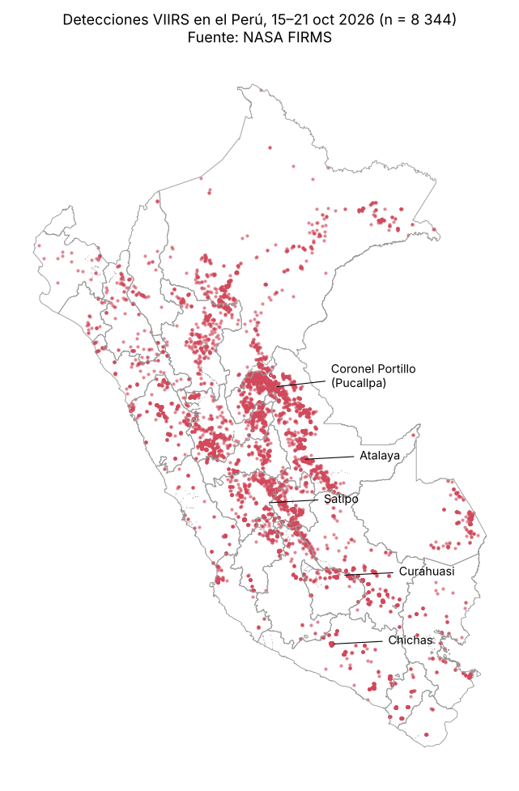
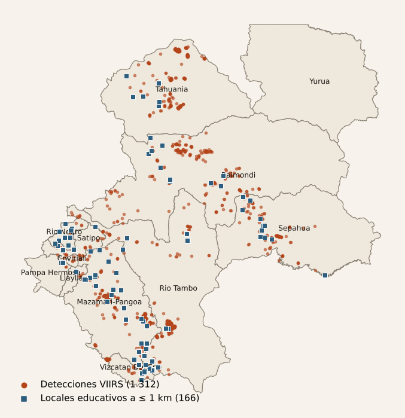

# Monitor de Incendios y Exposición Territorial — Perú

**Reto D · ¿A quién afecta?**, ampliado con escuelas y comunidades nativas.
Autora: Ana Karen Zamalloa Lima · Ciencia de Datos con Python, 2026-II · Sesión 07 (datos raster)

- **Dashboard en línea:** https://claude.ai/artifact/6oRiGEDFVQkkU915gMmWQ9
- **Dashboard local con relieve 3D real:** `dashboard/dashboard.html` (se abre en el navegador; necesita internet)
- **Presentación:** `presentation/presentacion.html`



## Pregunta de investigación

¿Qué edificaciones, personas, escuelas y comunidades nativas de las provincias de Satipo (Junín) y Atalaya (Ucayali) se encuentran próximas a las detecciones recientes de incendios, y qué distritos deberían priorizarse para una evaluación?

La zona no se eligió de antemano. Se seleccionó a partir de los datos: tras Coronel Portillo (Pucallpa), el corredor Satipo–Atalaya concentra la mayor actividad del país (1 312 detecciones, con actividad los siete días) y alberga 317 comunidades nativas.

## Fuentes de datos

| Fuente | Producto | Resolución / fecha | Uso |
|---|---|---|---|
| NASA FIRMS (API area) | VIIRS NRT S-NPP, NOAA-20, NOAA-21 | 375 m · 15–21 oct 2026 (UTC) · descarga 22-10-2026 01:41 UTC | Detecciones térmicas |
| Material del curso (sesión 07) | Shapefile DISTRITOS (INEI) | 1 873 distritos · EPSG:4326 | Unión espacial por IDDIST |
| Google Open Buildings v3 | Puntos, 4 celdas S2 nivel 4 | Modelo de mayo 2023 | Edificaciones |
| WorldPop R2025A v1 | PER 2026, constrained, 100 m | Personas por píxel | Población (raster) |
| MINEDU · ESCALE | Padrón web | Corte 14-10-2026 | Locales educativos |
| Ministerio de Cultura · BDPI | Localidades indígenas v5 | Sin coordenadas | Comunidades nativas y brechas |

**Área quemada: no disponible.** Los productos de área quemada (MODIS MCD64A1) son mensuales, de 500 m y se publican con uno o dos meses de rezago; no corresponden a la ventana de siete días.

## Metodología

1. **Control de calidad** de FIRMS: no hay nulos, duplicados ni coordenadas fuera de rango. De 10 907 detecciones, 2 563 caen fuera del Perú y se descartan tras la unión espacial con los distritos.
2. **Eventos:** las detecciones a ≤ 1 km entre sí se agrupan por enlace simple, lo que da ≈ 2 361 eventos en el Perú. Así se distinguen las detecciones de los incendios.
3. **Distancias en metros:** todas las capas se reproyectan a UTM 18S (EPSG:32718). Cada edificación y cada escuela se mide a su detección **más cercana** (`sjoin_nearest`), de modo que se cuenta una sola vez.
4. **Población (estadísticas zonales, como en la sesión 07):** se generan zonas de 500 m, 1 km y 5 km, **disueltas** en un solo polígono e intersectadas con cada distrito. Después se suma con `rasterstats.zonal_stats`, con `nodata` explícito y `all_touched=False`.
5. **Prioridad para evaluación** (sin pesos arbitrarios). **Alta:** actividad en ≥ 5 días y (≥ 1 000 edificaciones o ≥ 10 escuelas a ≤ 1 km). **Media:** una de esas condiciones, o ≥ 10 % de edificaciones a ≤ 1 km. **Baja:** el resto.

## Hallazgos

1. **A ≤ 1 km de una detección hay 11 939 edificaciones (7,1 %) y 22 729 personas (7,3 %)** de la zona. A ≤ 5 km la cifra sube a 77 % de las edificaciones y 251 127 personas (80 %): muchas detecciones ocurren junto a zonas habitadas y agrícolas.
2. **166 locales educativos están a ≤ 1 km de una detección, y 54 a ≤ 500 m.** Los más próximos son dos escuelas de Yainapango (Pangoa), a 40–45 m de una detección del 16 de octubre.
3. **La exposición recae sobre territorios con brechas previas.** En Raimondi, el 98 % de las viviendas de comunidades nativas no tiene agua y el 96 % no tiene electricidad; en Río Tambo, el 94 % y el 80 %. Mazamari-Pangoa, Río Tambo y Río Negro aparecen como prioridad alta para una evaluación.



## Ejecución

Requisitos: Python 3.11+ con `pip install -r requirements.txt` y una clave gratuita de FIRMS en `.env` (`FIRMS_MAP_KEY=...`, ver `.env.example`).

```bash
python src/descargar_firms.py --fin 2026-10-21     # focos (7 días hasta esa fecha, Lima)
python src/descargar_distritos.py                  # límites distritales del curso
python src/procesar_focos.py                       # calidad, distritos y eventos
python src/descargar_open_buildings.py             # edificaciones (≈ 420 MB)
python src/calcular_exposicion.py                  # edificaciones a 500 m / 1 km / 5 km
python src/procesar_poblacion.py                   # WorldPop (descargar antes en data/raw/poblacion/)
python src/escuelas_comunidades.py                 # ESCALE y BDPI (descargar antes en data/raw/)
```

Para actualizar a una nueva ventana de siete días, se ejecuta `descargar_firms.py` sin `--fin` (toma la fecha actual de Lima) y luego el resto de scripts. Los datos crudos y procesados no se suben al repositorio (ver `.gitignore`).

## Limitaciones

- Una detección térmica **no equivale a un incendio forestal confirmado**: puede ser una quema agrícola. Varias detecciones pueden corresponder al mismo evento.
- La distancia se mide al **centro del píxel** detectado, no al borde real del fuego. Los radios son parámetros analíticos, no umbrales oficiales.
- Una huella de Open Buildings **no es una vivienda ocupada**, y las imágenes son anteriores a mayo de 2023.
- WorldPop es una **estimación modelada** para 2026, no un conteo censal.
- Las coordenadas escolares las reportan las UGEL y DRE, y pueden ser aproximadas.
- La BDPI no trae coordenadas: las comunidades se analizan por distrito. Pangoa y Mazamari se suman porque el shapefile del curso los une (IDDIST 120699).
- Todo se reporta como **exposición potencial**, no como daño ni como riesgo real.

## Uso de IA

Los datos se descargaron con **Claude Code** en VS Code, y el código de procesamiento, el dashboard y la presentación se desarrollaron paso a paso con **Claude**. La pregunta, la zona, el enfoque en escuelas y comunidades nativas y la validación de cada resultado (fechas UTC, unidades de WorldPop, ausencia de doble conteo) estuvieron a cargo de la autora.
