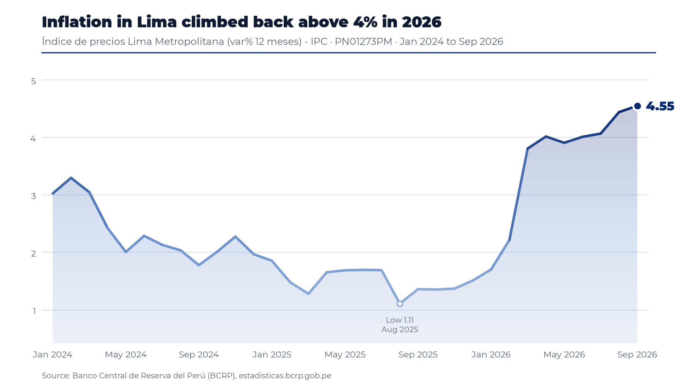
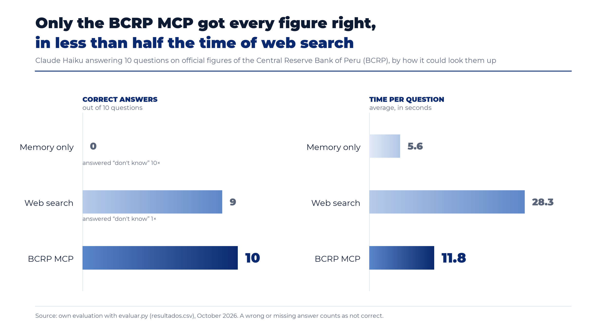

# Does a Dedicated MCP Server Keep a Language Model from Guessing? An Evaluation with Official Statistics from the Central Reserve Bank of Peru

**Author:** Ana Karen Zamalloa Lima
**Course:** Data Science with Python, Diplomado PUCP 2026, Session 04 (MCP: Claude connected to its data)
**Date:** 29 October 2026
**Repository folder:** `tarea_5/` · tracked in issue #20

---

## 1. Introduction

Large language models (LLMs) are increasingly asked for precise, up-to-date figures, yet their parametric knowledge is frozen at a training cutoff and, when pressed, they may produce plausible but unsupported numbers, a phenomenon widely described as *hallucination* (Ji et al., 2023). One established remedy is to ground the model in an external, authoritative source at query time (Lewis et al., 2020). The Model Context Protocol (MCP), released by Anthropic as an open standard in November 2024 and transferred to the Linux Foundation's Agentic AI Foundation in December 2025, standardises how such sources are exposed to a model as tools, resources and prompts (Anthropic, 2024; Linux Foundation, 2025).

Building on the course materials (D2CML, 2026) and the DeepLearning.AI short course on MCP (Schoppik, 2025), this report evaluates an MCP server that gives Claude access to the 17,167 official time series published by the Central Reserve Bank of Peru (BCRP). Specifically, it asks whether the server increases the share of correctly answered numerical questions and how it compares with general web search.

## 2. Method

### 2.1 The server

The server (`server.py`) was written in Python with FastMCP 4 (FastMCP, 2026) and passes the eight contract tests in `test_server.py` (`8 passed`). It exposes four tools, one resource and one prompt:

| Component | Type | Purpose |
|---|---|---|
| `buscar_series` | Tool (provided) | Searches the BCRP catalogue by keywords. |
| `serie` | Tool | Downloads a series between two dates, translates BCRP period labels (e.g. `Ene.2025`, `01.Oct.26`, `T1.25`) into sortable labels, skips `n.d.` values, retries when the API returns HTML, and returns the source URL. |
| `resumen` | Tool | Returns first, last, change, percent change, mean, maximum and minimum, so that the model never performs arithmetic itself. |
| `grafico` | Tool (own) | Saves a PNG line chart of any series, with an optional headline, labels for the last value, the high and the low, and the BCRP source. |
| `bcrp://serie/{codigo}` | Resource | Catalogue card of a series (name, category, frequency, first date, last update). |
| `informe(tema)` | Prompt | Requests a five-bullet brief in which every figure cites its series code and period. |

As an illustration, Figure 1 shows the chart that `grafico` produced for 12-month inflation in Lima, with a headline written by the user. Line and area colour follow the value, from pale blue for low readings to navy for high ones.



**Figure 1.** Output of the server's own tool, `grafico`, for series PN01273PM (January 2024 to September 2026).

The server was registered in Claude Code at project scope together with the reference `fetch` server (`.mcp.json`, no API keys). All five checks proposed in the assignment succeeded: both servers connected (`/mcp`), a question triggered `buscar_series` followed by `serie`, the resource was read through `@`, the prompt ran as `/mcp__bcrp__informe`, and `fetch` read a web page. Screenshots are stored in `evidencias/`.

### 2.2 Evaluation design

The evaluation used the course script `evaluar.py`, which sends each question to Claude Code in non-interactive mode (`claude -p`, model Haiku) and scores the numerical answer against an official value within a rounding tolerance. The question set (`preguntas.csv`) contained the eight questions supplied by the instructor plus two of my own, whose official values were checked by hand on the BCRP website (Section 4):

- `desempleo_set26`: Lima Metropolitana unemployment rate, three-month moving average, September 2026 (series PN38063GM; truth 4.4 %, tolerance 0.05).
- `gasto_gc_t2_26`: central government non-financial spending, second quarter of 2026 (series PN03309FQ; truth S/ 53,042 million, tolerance 1).

Two runs were carried out. The **base run** compared *memory only* (no tools) with *MCP* (`resultados_base.csv`). The **extra experiment** added a third mode, *web search*, through `--modos memoria web mcp` (`resultados.csv`). In every mode the instruction allowed the model to return `null` when it could not be certain, so a missing answer is scored as "don't know" rather than as an error. On Windows, the script was run with `PYTHONUTF8=1`; otherwise `subprocess` decodes Claude's UTF-8 output as cp1252 and fails.

## 3. Results

### 3.1 Accuracy and speed

**Table 1.** Base run: memory only versus MCP (10 questions).

| Mode | Correct | Wrong | Don't know | Mean seconds | Mean turns |
|---|---:|---:|---:|---:|---:|
| Memory only | 0 | 0 | 10 | 5.5 | 2.0 |
| BCRP MCP | **10** | 0 | 0 | 13.8 | 4.5 |

**Table 2.** Extra experiment: memory only, web search and MCP (10 questions).

| Mode | Correct | Wrong | Don't know | Mean seconds | Slowest question (s) | Mean turns |
|---|---:|---:|---:|---:|---:|---:|
| Memory only | 0 | 0 | 10 | 5.6 | 7.1 | 2.0 |
| Web search | 9 | 0 | 1 | 28.3 | 70.9 | 5.0 |
| BCRP MCP | **10** | 0 | 0 | **11.8** | 13.2 | 4.5 |



**Figure 2.** Correct answers and average seconds per question, by mode (extra experiment). Produced with `figura.py` from `resultados.csv`.

The MCP answered all ten questions correctly in both runs, whereas the model without tools answered none. Web search reached nine correct answers but required, on average, 28.3 seconds per question, that is, roughly 2.4 times the 11.8 seconds needed by the MCP. Notably, no mode produced a wrong figure: every miss was an explicit "don't know".

### 3.2 What each mode missed, and why

**Memory only (10 of 10 "don't know").** In every case the `fuente` column states that the model had no access to BCRP or INEI data and that the requested period lay beyond its knowledge cutoff (June 2026). Rather than inventing a number, it pointed to the official source, and in several answers it even noted that the project's BCRP server could provide the figure. This abstention, however, depends on the instruction to return `null`; the alternative experiment of removing that instruction was not run, so the report cannot say whether the model would otherwise have fabricated values.

**Web search (1 "don't know": copper, August 2026).** The BCRP statistics page that the model tried returned no content, and the search engine only surfaced a partial-month average from the London Metal Exchange reported by Cochilco (651.06 US¢/lb up to 28 August). The model correctly declined to report it, since that figure comes from a different source and period and lies about 5.6 % below the official BCRP value (689.70 US¢/lb). Furthermore, the `fuente` column reveals two weaknesses even among the nine correct answers. First, in five of them (the three consumer price questions, the policy rate and GDP growth) the model relied mainly on news outlets citing INEI or the BCRP and acknowledged that it had not opened the primary source; for GDP it reported INEI's 3.44 % rather than the BCRP series value of 3.4306 %, which was accepted only because of the tolerance. Second, for central government spending it summed three monthly values from a different series to obtain the quarterly total, which is precisely the kind of model-side arithmetic the MCP is designed to avoid.

**BCRP MCP (no misses).** Every answer cited the exact series code, the period and the API URL, and in two cases (policy rate and international reserves) the model cross-checked the value against a second BCRP series. Its values are therefore unrounded official figures (for instance, 4.37 % unemployment instead of the 4.4 % displayed on the website).

## 4. Manual verification of two figures

Following the assignment, the two new questions were checked by hand on the BCRP website and compared with the value returned by the server:

| Question | BCRP table (rounded) | MCP value (exact) | Difference | Table consulted |
|---|---:|---:|---:|---|
| Unemployment rate, Lima, Sep 2026 | 4.4 % | 4.3717 % | 0.028 | [PN38063GM](https://estadisticas.bcrp.gob.pe/estadisticas/series/mensuales/resultados/PN38063GM/html/2026-1/2026-9/) |
| Central government non-financial spending, 2026-Q2 | S/ 53,042 million | S/ 53,041.84 million | 0.16 | [PN03309FQ](https://estadisticas.bcrp.gob.pe/estadisticas/series/trimestrales/resultados/PN03309FQ/html/2026-1/2026-2/) |

Both differences stem solely from the rounding applied by the website and fall within the tolerances set in `preguntas.csv` (BCRP, 2026a, 2026b). Screenshots of both tables are stored in `evidencias/`.

## 5. Conclusion

Grounding Claude in an MCP server turned a model that could not answer any of the ten questions into one that answered all of them, each with a verifiable source. Web search came close in accuracy, yet it was more than twice as slow, depended largely on secondary sources and occasionally performed its own calculations. Consequently, an MCP is worth building when a task repeatedly needs exact figures from one authoritative source; web search remains sufficient for occasional questions on widely reported data. These conclusions are limited by a single run per mode, one model (Haiku) and ten questions.

## 6. Reproducibility

```bash
uv run pytest -q                                 # 8 passed
claude mcp add --scope project bcrp -- uv run server.py
claude mcp add --scope project fetch -- uvx mcp-server-fetch
uv run evaluar.py                                # base run (copied to resultados_base.csv)
uv run evaluar.py --modos memoria web mcp        # extra experiment (resultados.csv)
uv run figura.py                                 # grafico.png (Figure 2)
```

On Windows, set `$env:PYTHONUTF8 = "1"` before running `evaluar.py`. The figures use Montserrat, bundled in `fuentes/` under the SIL Open Font License.

## 7. Statement on the use of artificial intelligence

I used Claude (Anthropic) as a step-by-step tutor and coding assistant: it explained the assignment, proposed code for `serie`, `resumen`, `grafico`, the resource, the prompt and `figura.py`, helped me solve setup errors on Windows, and helped me draft and edit this report in English. I ran every test and command myself, checked the two new figures by hand on the BCRP website, chose the questions and the design of the figures, and reviewed the final text. In addition, Claude Code (Haiku) is the object being evaluated in Sections 2 and 3.

## References

Anthropic. (2024, November 25). *Introducing the Model Context Protocol*. https://www.anthropic.com/news/model-context-protocol

Banco Central de Reserva del Perú. (2026a). *Empleo mensual en Lima Metropolitana: Tasa de desempleo, promedio móvil tres meses (%)* [Data set, series PN38063GM]. BCRPData. Retrieved October 29, 2026, from https://estadisticas.bcrp.gob.pe/estadisticas/series/mensuales/resultados/PN38063GM/html/2026-1/2026-9/

Banco Central de Reserva del Perú. (2026b). *Gastos del gobierno central (millones S/): Gastos no financieros* [Data set, series PN03309FQ]. BCRPData. Retrieved October 29, 2026, from https://estadisticas.bcrp.gob.pe/estadisticas/series/trimestrales/resultados/PN03309FQ/html/2026-1/2026-2/

D2CML. (2026). *Sesión 04 · MCP: Claude conectado a sus datos* [Course materials, Data Science with Python]. GitHub. https://github.com/d2cml-ai/Data-Science-Python/tree/main/sessions/04-mcp-claude-code

FastMCP. (2026). *FastMCP documentation* (Version 4). https://gofastmcp.com

Ji, Z., Lee, N., Frieske, R., Yu, T., Su, D., Xu, Y., Ishii, E., Bang, Y. J., Madotto, A., & Fung, P. (2023). Survey of hallucination in natural language generation. *ACM Computing Surveys, 55*(12), Article 248. https://doi.org/10.1145/3571730

Lewis, P., Perez, E., Piktus, A., Petroni, F., Karpukhin, V., Goyal, N., Küttler, H., Lewis, M., Yih, W., Rocktäschel, T., Riedel, S., & Kiela, D. (2020). Retrieval-augmented generation for knowledge-intensive NLP tasks. *Advances in Neural Information Processing Systems, 33*, 9459–9474.

Linux Foundation. (2025, December 9). *Linux Foundation announces the formation of the Agentic AI Foundation (AAIF)* [Press release]. https://www.linuxfoundation.org/press

Schoppik, E. (2025). *MCP: Build rich-context AI apps with Anthropic* [Short course]. DeepLearning.AI. https://www.deeplearning.ai/short-courses/mcp-build-rich-context-ai-apps-with-anthropic/
