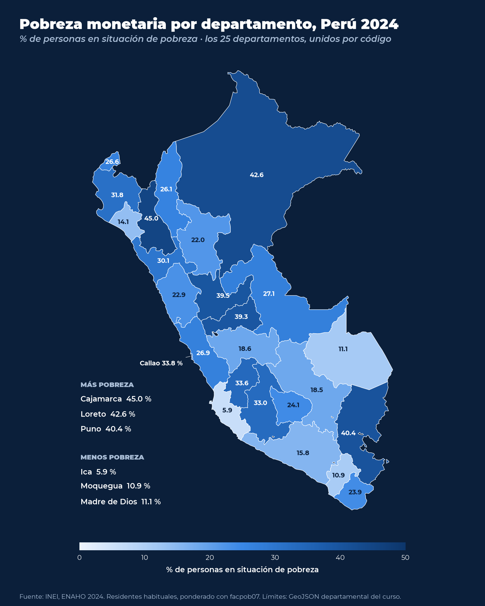
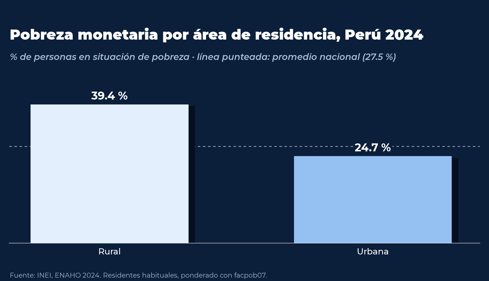
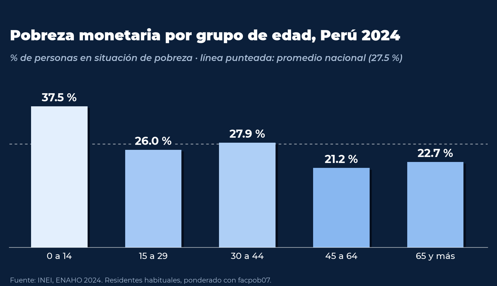

# Tarea 6. Skills de Claude Code para la limpieza, la visualización y la cartografía de la ENAHO 2024

Ana Karen Zamalloa Lima  
Diplomado de Ciencia de Datos para el Análisis Social y la Gestión Pública, Pontificia Universidad Católica del Perú  
Sesión 16, Issue #22

## Presentación

El presente trabajo desarrolla tres skills de Claude Code concebidas para operar de manera encadenada sobre la
Encuesta Nacional de Hogares (ENAHO) 2024 del Instituto Nacional de Estadística e Informática (INEI). La primera
skill limpia y articula los módulos de la encuesta, la segunda produce gráficos de pobreza monetaria y la tercera
elabora un mapa de la pobreza por departamento. En este sentido, el propósito central consiste en garantizar que
cualquier persona que clone el repositorio y formule a Claude Code una pregunta sobre la pobreza en el Perú obtenga
siempre la misma base de datos, las mismas cifras y las mismas figuras, en concordancia con la estimación oficial
del INEI.

Desde esta perspectiva, el proyecto responde al problema planteado en la sesión. Cuando se solicita a un modelo de
lenguaje que limpie la ENAHO en ocasiones distintas, este puede adoptar decisiones metodológicas diferentes en cada
intento, ya sea en el filtro de residentes, en el factor de expansión o en el tratamiento de las llaves de unión.
Por consiguiente, las skills fijan dichas decisiones en scripts versionados, de modo que la respuesta deje de
depender de la improvisación del modelo.



## Las tres skills

| Skill | Insumo | Producto |
|---|---|---|
| [`limpiando-enaho`](.claude/skills/limpiando-enaho/SKILL.md) | Módulos 34 (sumaria) y 02 (miembros) del INEI | `salidas/personas_2024.parquet` y `salidas/validacion.txt` |
| [`graficando-enaho`](.claude/skills/graficando-enaho/SKILL.md) | Base limpia y un criterio de desagregación (área, sexo, edad o departamento) | `figuras/pobreza_<criterio>.png` y su archivo CSV |
| [`mapeando-enaho`](.claude/skills/mapeando-enaho/SKILL.md) | Base limpia y límites de los 25 departamentos | `mapas/pobreza_departamento.png` y su archivo CSV |

Cabe señalar que las skills de gráficos y de mapas remiten a la skill de limpieza cuando la base de personas aún no
existe. De este modo, un único pedido puede activar dos skills de manera sucesiva, lo que permite que el flujo
completo se ejecute sin intervención adicional.

## Estructura del repositorio

```text
tarea_6/
├── .claude/skills/
│   ├── limpiando-enaho/    SKILL.md, reference.md, scripts/limpiar.py
│   ├── graficando-enaho/   SKILL.md, scripts/graficar.py, fuentes/ (Montserrat, SIL OFL)
│   └── mapeando-enaho/     SKILL.md, scripts/mapear.py
├── datos/                  archivos del INEI y GeoJSON (excluidos del repositorio)
├── salidas/validacion.txt  cifras de control de la limpieza
├── figuras/                gráficos de barras en PNG a 200 dpi y sus CSV
├── mapas/                  mapa departamental y su CSV
├── evaluacion.md           tres pedidos con y sin skills
├── pyproject.toml, uv.lock
└── README.md
```

## Procedimiento de reproducción

### Obtención de los datos

La carpeta `datos/` se encuentra excluida del control de versiones mediante `.gitignore`. Por ello, cada persona
debe descargar los archivos desde su navegador y guardarlos en `tarea_6/datos/`.

| Archivo | Enlace | Contenido |
|---|---|---|
| Módulo 34, Sumaria | [966-Modulo34.zip](https://proyectos.inei.gob.pe/iinei/srienaho/descarga/STATA/966-Modulo34.zip) | `sumaria-2024.dta`, con una fila por hogar |
| Módulo 02, Miembros del hogar | [966-Modulo02.zip](https://proyectos.inei.gob.pe/iinei/srienaho/descarga/STATA/966-Modulo02.zip) | `enaho01-2024-200.dta`, con una fila por persona |
| Límites departamentales | [peru_departamental_simple.geojson](https://raw.githubusercontent.com/d2cml-ai/Data-Science-Python/main/sessions/06-geoespacial/lab/Data/peru_departamental_simple.geojson) | 25 departamentos identificados por `FIRST_IDDP` |

El código 966 corresponde a la ENAHO 2024 en el portal de microdatos del INEI. Asimismo, el script de limpieza admite
tanto los archivos comprimidos como los archivos `.dta` ya extraídos. De manera complementaria, conviene verificar que
el navegador no añada la extensión `.txt` al archivo GeoJSON al momento de guardarlo.

### Instalación del entorno

El entorno se gestiona con [uv](https://docs.astral.sh/uv/), y las librerías empleadas (pandas, pyarrow, geopandas y
matplotlib) se encuentran fijadas en `pyproject.toml` y `uv.lock`. En consecuencia, basta con ejecutar la siguiente
instrucción desde la carpeta `tarea_6/`.

```bash
uv sync
```

### Uso de las skills con Claude Code

Claude Code debe iniciarse desde la carpeta `tarea_6/`, puesto que solo así reconoce las skills alojadas en
`.claude/skills/`. A continuación, basta con formular la pregunta en lenguaje natural, tal como se ilustra en los
siguientes ejemplos.

```bash
claude
> ¿Cuál fue la pobreza en Cusco en 2024?
> Grafica la pobreza urbana y rural
> Haz un mapa de la pobreza por departamento
```

### Ejecución directa de los scripts

Alternativamente, los scripts pueden ejecutarse sin Claude Code, siempre en el orden que se indica.

```bash
uv run .claude/skills/limpiando-enaho/scripts/limpiar.py --anio 2024
uv run .claude/skills/graficando-enaho/scripts/graficar.py --por area          # también sexo, edad o departamento
uv run .claude/skills/mapeando-enaho/scripts/mapear.py
```

## Validación de la limpieza

En términos metodológicos, la limpieza sigue los siete pasos establecidos en la sesión, a saber, la lectura, la
normalización, el filtrado, la unión, la construcción de variables, la validación y el guardado. Si alguna de las
comprobaciones falla, el script se detiene y no genera la base. La tabla siguiente resume las cifras registradas en
`salidas/validacion.txt`.

| Indicador | Resultado | Referencia |
|---|---|---|
| Residentes habituales | **108,664** de 117,721 registros | 108,664 |
| Hogares en la sumaria | 33,691 | 33,691 |
| Pobreza monetaria, sumaria ponderada con `factor07 × mieperho` | **27.58 %** | 27.6 % (INEI) |
| Pobreza monetaria, base de personas ponderada con `facpob07` | **27.53 %** | 27.6 % (INEI) |
| Pobreza extrema | 5.50 % | 5.5 % |
| Departamentos con dato | 25 | 25 |

A partir de los resultados obtenidos, se constata que la base replica la cifra oficial de pobreza monetaria del INEI.
Este resultado se sustenta en un conjunto de decisiones que la skill fija para que no se improvisen en cada pedido.
En primer lugar, las llaves de identificación se leen como texto, lo que preserva los ceros a la izquierda. En
segundo lugar, la columna `aÑo` se normaliza como `anio`. Asimismo, solo se conservan los residentes habituales,
definidos por la condición `(p204 == 1 & p205 == 2) | (p204 == 2 & p206 == 1)`, y la unión entre personas y hogares
se realiza con `validate="m:1"` para impedir duplicaciones silenciosas. Por último, la condición de pobreza se trata
como una categoría (`pobreza <= 2`) y nunca como un promedio, mientras que toda cifra referida a personas se pondera
con el factor de expansión `facpob07`.

## Gráficos

<p float="left">
  
  
</p>

Los gráficos atienden a las reglas establecidas en la sesión. En efecto, ponderan con `facpob07`, presentan barras que
parten de cero y se ordenan según su magnitud, emplean una sola gama cromática de azules y consignan el valor de cada
barra. Del mismo modo, el título indica el fenómeno y el periodo, la nota al pie atribuye la fuente al INEI y cada
figura se exporta en formato PNG a 200 dpi. En concordancia con lo anterior, el estilo visual, basado en un fondo azul
noche y en la tipografía Montserrat en sus variantes Black, SemiBold cursiva, Bold y Medium, se encuentra fijado en
el propio script, de manera que todas las figuras conforman una misma identidad gráfica.

## Evaluación

En las tres consultas realizadas con skills, Claude Code activó la skill pertinente sin que el pedido la nombrara y
replicó las cifras de referencia, esto es, 18.5 % de pobreza en Cusco, 24.7 % en el área urbana frente a 39.4 % en
el área rural y 45.0 % en Cajamarca. Asimismo, una primera prueba permitió detectar y corregir una instrucción
ambigua en `graficando-enaho`. Sin skills, en cambio, Claude obtuvo las mismas cifras, aunque lo hizo reutilizando
las salidas y los scripts de las skills que ya se encontraban en el repositorio. El análisis detallado, que incluye
las diferencias de décimas respecto de las referencias y las limitaciones de la prueba, se encuentra en
[`evaluacion.md`](evaluacion.md).

## Referencias

Anthropic. (2026). *Skills en Claude Code*. https://code.claude.com/docs/en/skills

d2cml-ai. (2026). *Data Science con Python, sesión 16, Skills ENAHO* [Repositorio de GitHub].
https://github.com/d2cml-ai/Data-Science-Python/tree/main/sessions/16-skills-enaho

Instituto Nacional de Estadística e Informática. (2025). *Encuesta Nacional de Hogares (ENAHO) 2024, módulos 34 y 02*
[Base de datos]. Portal de microdatos del INEI.

Ulanovsky, J. (s. f.). *Montserrat* [Tipografía, SIL Open Font License]. https://github.com/JulietaUla/Montserrat