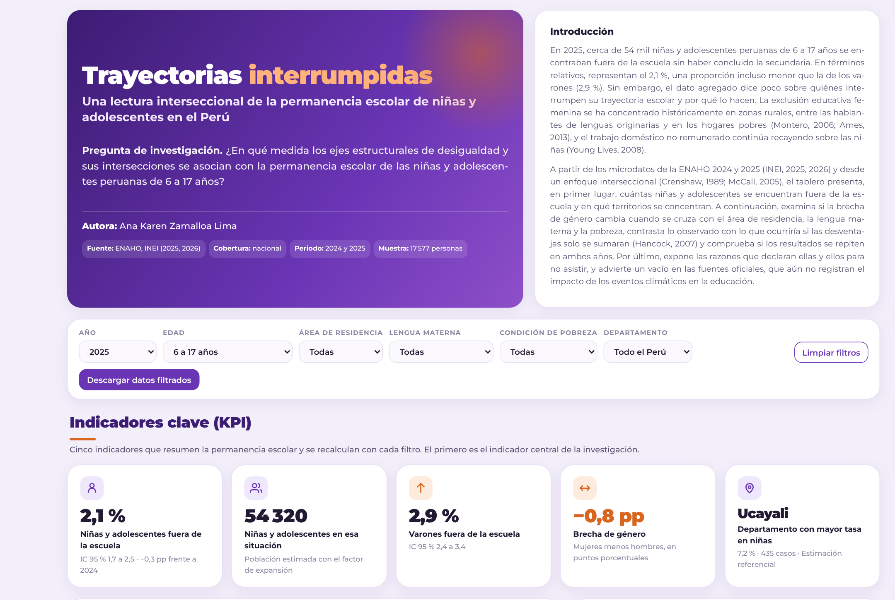
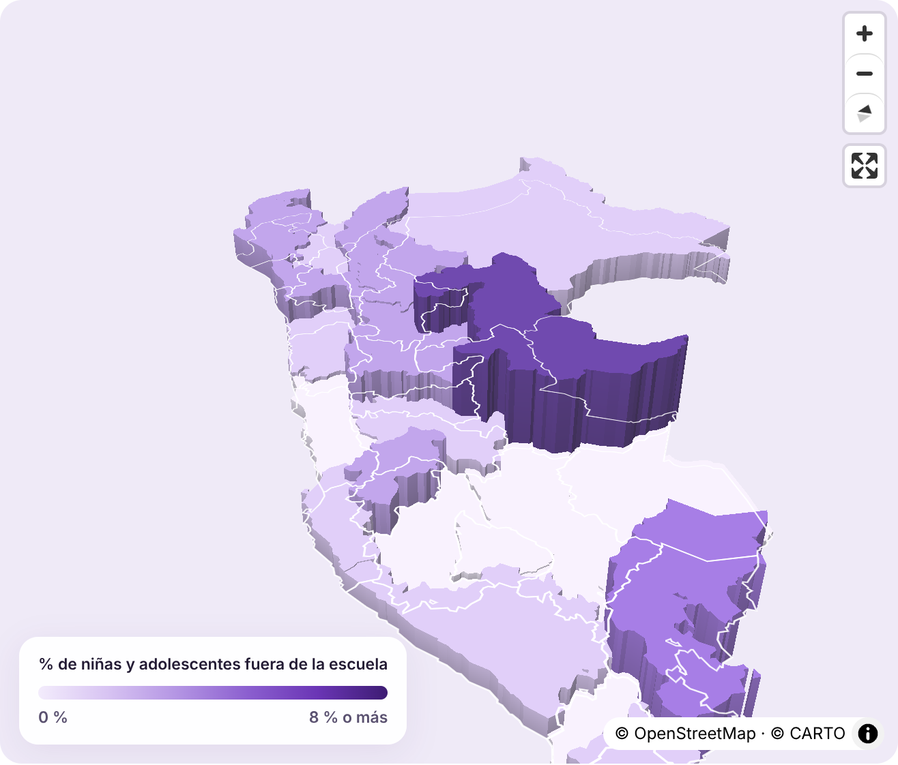
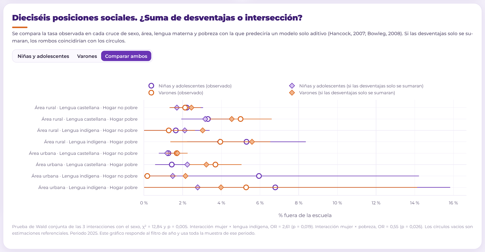
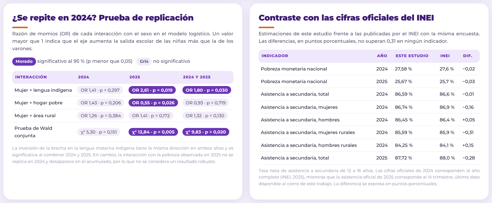

# Trayectorias interrumpidas. Una lectura interseccional de la permanencia escolar de niñas y adolescentes en el Perú

Ana Karen Zamalloa Lima  
Diplomado de Ciencia de Datos para el Análisis Social y la Gestión Pública, Pontificia Universidad Católica del Perú  
Ciencia de Datos con Python · Tarea 3 ([Issue #197](https://github.com/d2cml-ai/Data-Science-Python/issues/197)), desarrollada en la carpeta `tarea_7/` de este repositorio

- **Dashboard público** https://anakaren-zl.github.io/data-science-python-2026/tarea_7/web/
- **Publicación en LinkedIn** [por completar con el enlace de la publicación]
- **Reel** `reel/reel.mp4` · guion en `reel/guion.json`



## 1. Tema y pregunta de investigación

El proyecto examina la permanencia escolar de las niñas y adolescentes peruanas desde un enfoque interseccional. La pregunta que orienta el análisis es la siguiente.

> ¿En qué medida los ejes estructurales de desigualdad y sus intersecciones se asocian con la permanencia escolar de las niñas y adolescentes peruanas de 6 a 17 años?

La formulación responde a dos criterios. Por un lado, emplea un verbo de asociación y no de causalidad, puesto que la fuente es una encuesta transversal que no permite identificar efectos causales. Por otro lado, no presupone que la intersección de categorías produzca desigualdad, sino que la trata como una cuestión empírica abierta, tal como propone Hancock (2007). Los ejes de desigualdad considerados son el área de residencia, la lengua materna y la condición de pobreza, que la literatura peruana identifica como las dimensiones que se cruzan con el género en el acceso a la educación (Muñoz, 2019; Cavero, Montalva y Rodríguez, 2011).

## 2. Descripción del proyecto

En 2025, cerca de 54 mil niñas y adolescentes peruanas de 6 a 17 años se encontraban fuera de la escuela sin haber concluido la secundaria. En términos relativos, representan el 2,1 %, una proporción incluso menor que la de los varones (2,9 %). Sin embargo, la cifra agregada dice poco sobre qué niñas ven interrumpida su trayectoria escolar y por qué. La exclusión educativa femenina se ha concentrado históricamente en zonas rurales, entre las hablantes de lenguas originarias y en los hogares pobres (Montero, 2006; Ames, 2013), y el trabajo doméstico no remunerado continúa recayendo sobre las niñas (Young Lives, 2008).

El marco de análisis es la interseccionalidad, entendida como un sistema complejo de estructuras de opresión múltiples y simultáneas (Crenshaw, 1995, citado en MIMP, 2016). Desde esta perspectiva, las desigualdades de clase, género y etnicidad no operan de manera aislada, sino que se articulan históricamente en realidades concretas (Jelin, 2014). En el contexto latinoamericano, Viveros Vigoya (2016) propone una aproximación situada que permite incorporar la ruralidad y la condición indígena como ejes propios de la dominación, mientras que, en el plano metodológico, Hancock (2007) y McCall (2005) plantean tratar la relación entre categorías como una cuestión empírica abierta. Asimismo, el trabajo asume que la educación constituye un derecho humano y una capacidad básica que amplía la libertad de las personas (Sen, 2000).

Sobre esta base, el proyecto procesa los microdatos de la Encuesta Nacional de Hogares (ENAHO) de 2024 y 2025 (INEI, 2025, 2026), estima la proporción de niñas, niños y adolescentes que interrumpe su trayectoria escolar en dieciséis posiciones sociales, contrasta lo observado con lo que predeciría un modelo solo aditivo, comprueba si los resultados de 2025 se replican en 2024 y presenta los resultados en un dashboard interactivo y en un reel narrado con voz clonada.

## 3. Fuentes de datos y metodología

### 3.1 Fuentes

| Fuente | Producto | Uso |
|---|---|---|
| INEI, [portal de microdatos](https://proyectos.inei.gob.pe/microdatos/) | ENAHO anual 2025 (código 1031) y 2024 (código 966), módulo 03 Educación (`Enaho01A-AAAA-300.csv`) | Asistencia, nivel aprobado, lengua materna, razones de inasistencia, sexo, edad y factor de expansión |
| INEI, portal de microdatos | ENAHO 2025 y 2024, módulo 02 Miembros del hogar (`Enaho01-AAAA-200.csv`) | Control de cobertura de los residentes de 6 a 17 años |
| INEI, portal de microdatos | ENAHO 2025 y 2024, módulo 34 Sumaria (`Sumaria-AAAA.csv`) | Condición de pobreza monetaria del hogar |
| INEI (2026), [Informe técnico de pobreza monetaria 2016-2025](https://www.gob.pe/institucion/inei/informes-publicaciones/8087825-cifras-de-pobreza-2025) | Pobreza monetaria de 27,6 % (2024) y 25,7 % (2025) | Validación |
| INEI (2025), [Estadísticas con enfoque de género](https://www.inei.gob.pe/media/MenuRecursivo/boletines/informe-tecnico_estadisticasdegenero_itrim2025.pdf) | Tasa neta de asistencia a secundaria 2024, total, por sexo y en el área rural | Validación y contraste |
| INEI (2025), [Condiciones de vida en el Perú, III trimestre 2025](https://www.inei.gob.pe/media/MenuRecursivo/boletines/7548592-condiciones-de-vida-en-el-peru-iii-trimestre-2025.pdf) | Tasa neta de asistencia a secundaria 2025 cercana a 88 % | Validación y contraste |
| UNFPA (2026), con datos de la ENDES 2025, citado en [Forbes Perú](https://forbes.pe/actualidad/2026-09-18/el-embarazo-adolescente-en-peru-bajo-pero-aun-presenta-grandes-diferencias-dentro-del-pais/) | Tasa de embarazo adolescente por área de residencia | Contexto de la limitación sobre las razones de inasistencia |
| Plan International Perú (2026), citado en [La República](https://larepublica.pe/sociedad/2026/10/16/fenomeno-el-nino-pone-en-riesgo-la-educacion-y-proteccion-de-ninas-y-adolescentes-668464) | Sondeo *Emergencias, cambio climático y derechos* | Evidencia no oficial sobre clima y asistencia escolar |
| MINAM (2016), [D. S. N.° 012-2016-MINAM](https://leap.unep.org/en/countries/pe/national-legislation/decreto-supremo-no-012-2016-minam-plan-de-accion-en-genero-y) | Plan de Acción en Género y Cambio Climático | Contraste entre la política climática y la fuente estadística |
| Material del curso, sesión 06 | `peru_departamental_simple.geojson` | Mapa de los 25 departamentos |

Los microdatos de ambos años se descargaron el 1 de noviembre de 2026 desde el portal del INEI, y el script `obtener_datos.py` registra la fecha de cada descarga en `datos/originales/descarga.txt`. Los zip originales (unos 70 MB) no se suben al repositorio por su tamaño, pero el mismo script permite obtenerlos nuevamente.

Se eligió la ENAHO anual porque es la única fuente oficial que permite cruzar, para una misma persona, el sexo, el área de residencia, la lengua materna, la condición de pobreza y las razones de inasistencia. El año 2025 es el más reciente disponible, mientras que 2024 se incorpora para comprobar si los resultados se replican y para comparar ambos periodos. Las bases trimestrales de 2026 se descartaron por dos razones. En primer lugar, la condición de pobreza monetaria solo se calcula con la base anual. En segundo lugar, un trimestre contiene aproximadamente la cuarta parte de la muestra anual, lo que impediría estimar con precisión las posiciones sociales más pequeñas.

### 3.2 Población e indicador

La población de estudio comprende a las y los residentes habituales de 6 a 17 años, rango que abarca las edades de la educación primaria y secundaria. Se considera residente habitual a quien es miembro del hogar y no ha estado ausente treinta días o más, o a quien no es miembro pero ha estado presente treinta días o más, criterio que coincide con el empleado por el INEI.

El indicador central es la **interrupción de la trayectoria escolar**, definida como la condición de no estar matriculado o no asistir actualmente a un centro educativo (preguntas 306 y 307) sin haber concluido la educación secundaria (pregunta 301A). La permanencia escolar es su complemento. Se descarta a quienes ya concluyeron la secundaria porque su salida del sistema no constituye una interrupción.

### 3.3 Decisión sobre el periodo de entrevista

Se conservan únicamente las entrevistas realizadas entre abril y diciembre. Esta decisión se justifica empíricamente, ya que entre enero y marzo el 87,3 % (2024) y el 89,3 % (2025) de las personas de 6 a 17 años que no estaban matriculadas declaró encontrarse de vacaciones, lo que impide distinguir la interrupción escolar del receso del calendario. La validación confirma la pertinencia de esta decisión, puesto que con el periodo lectivo la tasa neta de asistencia a secundaria de 2024 (86,59 %) reproduce la cifra anual oficial del INEI (86,6 %).

### 3.4 Ejes de desigualdad

| Eje | Variable | Categorías |
|---|---|---|
| Sexo | P207 | Mujer, hombre |
| Área de residencia | ESTRATO | Urbana (estratos 1 a 5), rural (estratos 6 a 8) |
| Lengua materna | P300A | Castellano (4), indígena (quechua, aimara, otra lengua nativa y lenguas amazónicas, códigos 1, 2, 3 y 10 a 15) |
| Condición de pobreza | POBREZA de la sumaria | Pobre (extremo y no extremo), no pobre |

La lengua materna se emplea como aproximación a la pertenencia a un pueblo indígena porque es la variable disponible en el módulo de educación para todas las edades de interés.

### 3.5 Análisis

Todas las cifras se ponderan con el factor de expansión del módulo de educación (FACTORA07). Los intervalos de confianza al 95 %, incluidos los de las diferencias entre niñas y varones en cada razón de inasistencia, se calculan con el tamaño efectivo de Kish, y las estimaciones con un coeficiente de variación superior al 15 % se marcan como referenciales, siguiendo el criterio del INEI.

El análisis adopta el enfoque intercategorial de McCall (2005), que utiliza provisionalmente las categorías existentes para documentar desigualdades entre grupos. En consecuencia, se cruzan los cuatro ejes en dieciséis posiciones sociales. Con el fin de evitar el supuesto aditivo que advierte Bowleg (2008), se estiman dos modelos logísticos ponderados, con errores estándar agrupados por conglomerado. El primero solo suma los efectos de cada eje, mientras que el segundo incorpora interacciones entre el sexo y los demás ejes. Una prueba de Wald conjunta contrasta si dichas interacciones son nulas, es decir, si la brecha de género es la misma en todas las posiciones sociales.

Los modelos se estiman por separado para 2024 y 2025, lo que funciona como prueba de replicación, y luego con ambos años juntos, controlando por el año y agrupando los errores por conglomerado y año. Se considera robusto un resultado que mantiene su dirección en ambos años y es significativo en el periodo acumulado.

### 3.6 Validación y contraste con las cifras oficiales

| Control | 2024 | 2025 |
|---|---|---|
| Residentes de 6 a 17 años del módulo 200 presentes en el módulo 300 | 24 393 de 24 393 (100 %) | 23 345 de 23 345 (100 %) |
| No matriculados de enero a marzo que declaran estar de vacaciones | 87,3 % | 89,3 % |
| Base final de análisis (abril a diciembre) | 18 152 personas, 8 896 mujeres | 17 577 personas, 8 649 mujeres |

Además, las estimaciones de este estudio se contrastaron con ocho cifras publicadas por el INEI con la misma encuesta (`datos/procesados/contraste_oficial.csv`). La mayor diferencia es de 0,31 puntos porcentuales.

| Indicador | Año | Este estudio | INEI | Diferencia (pp) |
|---|---|---|---|---|
| Pobreza monetaria nacional | 2024 | 27,58 % | 27,6 % | −0,02 |
| Pobreza monetaria nacional | 2025 | 25,67 % | 25,7 % | −0,03 |
| Asistencia a secundaria, total | 2024 | 86,59 % | 86,6 % | −0,01 |
| Asistencia a secundaria, mujeres | 2024 | 86,74 % | 86,9 % | −0,16 |
| Asistencia a secundaria, hombres | 2024 | 86,45 % | 86,4 % | +0,05 |
| Asistencia a secundaria, mujeres rurales | 2024 | 85,59 % | 85,9 % | −0,31 |
| Asistencia a secundaria, hombres rurales | 2024 | 84,25 % | 84,1 % | +0,15 |
| Asistencia a secundaria, total | 2025 | 87,72 % | 88,0 % (III trimestre) | −0,28 |

## 4. Hallazgos principales

**Hallazgo 1. El promedio nacional oculta las desigualdades.** En 2025, el 2,1 % de las niñas y adolescentes de 6 a 17 años se encontraba fuera de la escuela sin haber concluido la secundaria (IC 95 % de 1,7 a 2,5), frente al 2,9 % de los varones (IC 95 % de 2,4 a 3,4). En términos absolutos, esta proporción equivale a unas 54 mil niñas y adolescentes. La misma relación se observa en 2024 (2,4 % frente a 2,9 %) y coincide con las cifras oficiales, según las cuales la asistencia a secundaria de las adolescentes es ligeramente superior a la de los varones (INEI, 2025). Considerado de manera aislada, el dato sugeriría la inexistencia de una desventaja femenina, en concordancia con Rojas, Guerrero y Vargas (2016), quienes no encuentran diferencias de género en la conclusión escolar en el Perú.

**Hallazgo 2. La lengua materna indígena invierte la brecha de género, y el resultado se replica.** En 2025, la prueba de Wald rechaza que la brecha de género sea igual en todas las posiciones sociales (χ² = 12,84 con 3 grados de libertad, p = 0,005). Entre quienes tienen el castellano como lengua materna, las niñas están menos fuera de la escuela que los varones (1,6 % frente a 2,5 %). En cambio, entre quienes tienen una lengua materna indígena la relación se invierte (4,2 % frente a 2,6 %), con una interacción significativa (OR = 2,61, p = 0,019). El patrón se repite en 2024, cuando el 4,0 % de las niñas de lengua indígena estaba fuera de la escuela frente al 3,1 % de los varones, mientras que entre quienes hablan castellano la relación era la opuesta (2,1 % frente a 2,7 %). Al combinar ambos años, la interacción se mantiene significativa (OR = 1,80, p = 0,030). Por el contrario, la interacción con la pobreza observada en 2025 (OR = 0,55, p = 0,026) no se replica en 2024 y desaparece en el periodo acumulado (p = 0,719), por lo que no se considera un resultado robusto. En conjunto, la evidencia respalda la tesis de Hancock (2007) y Bowleg (2008), según la cual la desventaja no resulta de la suma de categorías, sino de su intersección, en este caso entre el género y la condición lingüística.

**Hallazgo 3. Los quehaceres del hogar constituyen una barrera específicamente femenina.** Con 2024 y 2025 combinados, el 14,1 % de las niñas y adolescentes fuera de la escuela declara dedicarse a los quehaceres del hogar como principal razón, frente al 1,7 % de los varones (+12,4 pp, IC de 7,3 a 17,6). La diferencia es significativa también en cada año por separado (+11,3 pp en 2024 y +13,7 pp en 2025). Asimismo, los problemas familiares pesan más entre ellas (18,2 % frente a 7,6 %, +10,6 pp, IC de 4,3 a 17,0), mientras que entre los varones predominan el trabajo (24,7 % frente a 13,5 %) y el desinterés por el estudio (16,6 % frente a 6,7 %), ambas diferencias significativas. Este patrón coincide con lo documentado por Young Lives, que identifica una mayor participación de los niños en actividades remuneradas y de las niñas en tareas domésticas no remuneradas (Young Lives, 2008), de modo que el trabajo de cuidado aparece como una barrera específicamente femenina para la permanencia escolar.

**Hallazgo complementario sobre las fuentes.** El Plan de Acción en Género y Cambio Climático reconoce que el cambio climático afecta de manera diferenciada a mujeres y niñas, incluye la educación y la gestión del riesgo entre sus áreas prioritarias y plantea como objetivo producir información diferenciada sobre estos impactos. Sin embargo, la pregunta 313A de la ENAHO, que registra la principal razón de inasistencia, no contempla los desastres ni los eventos climáticos entre sus opciones. Por consiguiente, la principal fuente oficial sobre educación en los hogares no permite medir una dimensión que la propia política climática del Estado considera relevante, aun cuando el país atraviesa una alerta de El Niño Costero en 2026 y un sondeo de Plan International Perú encontró que casi la mitad de las adolescentes consultadas vio afectada su asistencia a clases por emergencias climáticas (Plan International Perú, 2026). La misma pregunta tampoco ofrece el embarazo o la maternidad como opción, pese a que en 2025 la tasa de embarazo adolescente fue de 16,3 % en las áreas rurales y de 5,4 % en las urbanas, según la ENDES (UNFPA, 2026). En consecuencia, dos razones que afectan sobre todo a las niñas quedan fuera del registro oficial, y es probable que una parte de ellas se refleje en la categoría de problemas familiares.

## 5. Limitaciones

- La ENAHO es una encuesta transversal, por lo que los resultados expresan asociaciones y no relaciones causales.
- La interrupción escolar es un evento poco frecuente. Por ello, varias posiciones sociales y la mayoría de los departamentos presentan coeficientes de variación superiores al 15 %, de modo que esas estimaciones son referenciales y se presentan con sus intervalos de confianza. Las conclusiones del hallazgo 2 se apoyan en el modelo, que emplea toda la muestra.
- El modelo no incorpora el diseño muestral completo de la ENAHO (estratos), aunque sí la ponderación y el agrupamiento por conglomerado.
- La razón de inasistencia es la principal declarada y no recoge causas múltiples, además de que suele ser respondida por la persona informante del hogar.
- La lengua materna aproxima la condición indígena, pero no equivale a la autoidentificación étnica.
- La exclusión de las entrevistas de enero a marzo reduce la muestra en cerca de una cuarta parte, aunque evita confundir las vacaciones con la interrupción escolar.
- Dos años permiten comprobar la replicación de los resultados, pero no bastan para identificar una tendencia, de modo que las variaciones entre 2024 y 2025 deben leerse con cautela.
- La pregunta sobre las razones de inasistencia no incluye el embarazo ni los eventos climáticos, por lo que estas causas no pueden cuantificarse con la ENAHO.
- Se consideraron las tasas de deserción interanual de ESCALE (Minedu), pero no se emplearon porque provienen de registros administrativos que no informan la pobreza ni la lengua materna del hogar, y porque miden un fenómeno distinto, la salida del sistema entre un año escolar y el siguiente.

## 6. Dashboard

El dashboard es una página web estática (HTML, JavaScript, MapLibre GL y Plotly), publicada con GitHub Pages en https://anakaren-zl.github.io/data-science-python-2026/tarea_7/web/. Se optó por una página sin servidor porque carga rápido, no depende de un servicio externo que pueda suspenderse y todos los cálculos se reproducen en el navegador a partir de los microdatos procesados, con la misma fórmula que emplea `analizar_datos.py`.

### 6.1 Presentación y contexto

La cabecera presenta el título, la pregunta de investigación, la autora, la fuente (ENAHO 2024 y 2025 del INEI), la cobertura geográfica (nacional, 25 departamentos), el periodo (entrevistas de abril a diciembre) y el tamaño de la muestra, que se actualiza con los filtros. A su lado, una introducción describe el problema y anticipa el recorrido del tablero.

### 6.2 Indicadores principales (cinco KPIs)

| KPI | Por qué es relevante |
|---|---|
| % de niñas y adolescentes fuera de la escuela sin secundaria completa, con su IC 95 % y su variación respecto del otro año | Es el indicador central de la pregunta de investigación, y la variación permite comparar periodos |
| Niñas y adolescentes en esa situación (población estimada) | Traduce la tasa a una magnitud absoluta, comprensible para el público general |
| % de varones fuera de la escuela, con su IC 95 % | Permite la comparación por sexo que exige el enfoque de género |
| Brecha de género (mujeres menos hombres, en puntos porcentuales) | Resume la desigualdad en una sola cifra y cambia de signo según la posición social filtrada |
| Departamento con mayor tasa en niñas | Identifica la dimensión territorial, considerando solo departamentos con al menos 100 casos e indicando si la estimación es referencial |

Todos los KPIs se recalculan con cada filtro.

### 6.3 Visualizaciones (nueve)

| Visualización | Qué muestra y por qué se eligió |
|---|---|
| Mapa 3D de los 25 departamentos | La altura y el color expresan la tasa de niñas, la de varones o la brecha. Se usa un mapa porque la pregunta tiene una dimensión territorial explícita, y la tercera dimensión permite comparar magnitudes sin depender solo del color |
| Ranking departamental | Complementa el mapa con las cifras exactas, el número de casos y la marca de estimación referencial |
| Línea por edad simple y sexo | Muestra en qué edad se concentra la interrupción, lo que conecta con la literatura sobre la transición a la secundaria |
| Brechas por eje de desigualdad, con intervalos de confianza | Compara niñas y varones dentro de cada categoría y evidencia que la brecha cambia de dirección en la lengua indígena |
| Dieciséis posiciones sociales frente al modelo aditivo | Es la prueba visual del enfoque interseccional (Hancock, 2007; Bowleg, 2008) |
| Razones de inasistencia por sexo | Sustenta el hallazgo 3 |
| Composición de quienes están fuera (gráfico solar) | Muestra cómo se distribuyen las niñas fuera de la escuela entre área, lengua y pobreza |
| Tabla de replicación 2024, 2025 y acumulado | Muestra qué interacciones se repiten entre años y cuáles no, lo que distingue los resultados robustos de los frágiles |
| Tabla de contraste con las cifras oficiales | Demuestra que el procesamiento reproduce ocho cifras publicadas por el INEI |



### 6.4 Controles interactivos

| Control | Efecto |
|---|---|
| Año (2025, 2024 o ambos) | Filtro temporal. Actualiza todos los KPIs, el mapa, el ranking, los gráficos y el modelo de las dieciséis posiciones |
| Edad (6 a 17, 6 a 11, 12 a 17, 15 a 17 años) | Actualiza los KPIs, el mapa, el ranking y los gráficos de edad, brechas, razones y composición |
| Área de residencia | Igual que el anterior |
| Lengua materna | Igual que el anterior |
| Condición de pobreza | Igual que el anterior |
| Departamento (lista o clic en el mapa) | Filtra todo el tablero y centra el mapa en el departamento elegido |
| Indicador del mapa (niñas, varones o brecha) | Cambia la altura, el color, la leyenda y el orden del ranking |
| Fondo del mapa (satelital o claro) y pausa del giro | Facilita la lectura del territorio |
| Sexo en el gráfico de posiciones (niñas, varones o ambos) | Permite comparar ambos modelos |
| Descarga de los datos filtrados | Exporta en CSV los microdatos que cumplen los filtros activos |
| Botón «Reproducir» del gráfico de edad | Dibuja la línea edad por edad, animación que también se activa al llegar al gráfico y al cambiar un filtro. Al pasar el cursor, una línea guía compara ambos sexos en la misma edad |
| Clic en el gráfico solar | Amplía el segmento elegido (por ejemplo, solo el área rural) y permite volver al total |

### 6.5 Hallazgos, metodología, fuentes y limitaciones

El dashboard incluye una sección titulada «Hallazgos principales», accesible también desde la barra lateral, con los tres hallazgos numerados. A continuación presenta la metodología (fuente y población, construcción del indicador, enfoque interseccional y validación contra las cifras del INEI), las limitaciones, la declaración de uso de inteligencia artificial y, al final, las fuentes en orden alfabético.





## 7. Reel

| Requisito | Cómo se cumple |
|---|---|
| Guion de 45 a 75 segundos, entre 5 y 7 escenas | El reel final dura 67,9 segundos y tiene 6 escenas, según el guion de `reel/guion.json`. El cuaderno de Colab verifica la duración al terminar |
| Inicio con gancho, desarrollo y cierre | La primera escena abre con la cifra de 54 mil niñas y una pregunta, las escenas 2 a 5 presentan los hallazgos (incluida su replicación en 2024) y la escena 6 cierra con una conclusión que invita a la reflexión, acompañada de una cita de Audre Lorde (1984) sobre la interseccionalidad |
| Cifras sustentadas en los datos | Cada cifra del guion coincide con `datos/procesados/`. Las correcciones hechas a mano se anotan en el campo `revisado_a_mano` de cada escena |
| Narración con IA a partir de la voz propia | Qwen3-TTS (Alibaba, licencia Apache 2.0) clona una grabación de 15 a 25 segundos de la voz de la autora. Whisper calcula la tasa de error por escena (WER) para comprobar que la narración se entienda y que las cifras se pronuncien bien. En el reel final, el WER varía entre 0 y 0,09 (registrado en `reel/guion.json`) |
| Imágenes, gráficos y mapas | El reel combina el gráfico por edad y el mapa del dashboard con siete imágenes generadas con IA (Canva) que dan contexto a la narración, todas en `reel/recursos/`. Las imágenes se diseñaron para evitar representaciones estereotipadas de la pobreza o de la ruralidad, muestran a las niñas en la escuela y no como víctimas, y recorren la Amazonía, los Andes y la ciudad, en coherencia con los datos, según los cuales la mayoría de las niñas fuera de la escuela vive en áreas urbanas. Algunas escenas cambian de fondo a mitad de la frase y cada imagen entra con un acercamiento lento. Además, cada cifra cuenta desde cero, una barra de avance marca las seis escenas y el diseño ocupa todo el formato vertical, de modo que el video no se reduce a cifras sobre un fondo estático |
| Música con licencia adecuada y volumen menor | La música se genera con Python a partir de ondas senoidales, por lo que no tiene derechos de autor de terceros, y se mezcla 22 dB por debajo de la voz |
| Subtítulos sincronizados | Whisper alinea cada palabra con la narración. Los subtítulos se queman en el video, con la palabra actual resaltada, y se guardan en `reel/subtitulos.srt` |
| Formato vertical | 1080 × 1920 píxeles (9:16) |
| Transparencia | El video muestra el aviso «Voz generada con IA» durante toda su duración y un pie con la autora, la fuente (INEI, 2025, 2026) y los créditos del mapa base, de las imágenes generadas con IA y de la música |

El reel se genera con `reel/hacer_reel.py`, que reutiliza sin modificaciones el código de la sesión 15 del curso y solo cambia la paleta, la tipografía y el diseño de cada escena. Para no instalar los modelos en una computadora personal, `reel/reel_colab.ipynb` permite ejecutarlo en Google Colab con GPU. La grabación de voz no se publica en el repositorio.

## 8. Enlaces y publicación en LinkedIn

- Dashboard https://anakaren-zl.github.io/data-science-python-2026/tarea_7/web/
- Repositorio https://github.com/anakaren-zl/data-science-python-2026/tree/main/tarea_7
- Publicación de LinkedIn [por completar]

La publicación (texto en `reel/post_linkedin.md`) incluye el reel, dos capturas del dashboard (`web/assets/capturas/`) en el primer comentario, dado que LinkedIn no permite combinar video e imágenes en una misma publicación, una explicación del tema con los tres hallazgos, los enlaces al dashboard y al repositorio, y la advertencia de que algunas cifras desagregadas son referenciales, con el fin de evitar afirmaciones exageradas.

## 9. Reproducción del proyecto

```text
tarea_7/
├── README.md
├── requirements.txt
├── datos/
│   ├── originales/       zip del INEI, GeoJSON y fecha de descarga (los zip no se suben)
│   └── procesados/       base analítica, tablas del análisis y validación
├── scripts/
│   ├── obtener_datos.py  descarga los módulos 02, 03 y 34 de la ENAHO 2024 y 2025, y el GeoJSON
│   ├── procesar_datos.py limpia, une, construye el indicador y valida contra el INEI
│   └── analizar_datos.py estima las tasas, las 16 posiciones, los modelos y prepara el dashboard
├── web/
│   ├── index.html        dashboard (MapLibre GL y Plotly, sin servidor)
│   ├── assets/           librerías, tipografía Montserrat y capturas del dashboard
│   └── data/             datos.json y departamentos.geojson
└── reel/
    ├── guion.json
    ├── hacer_reel.py     genera el reel con el código de la sesión 15
    ├── reel_colab.ipynb  versión para Google Colab con GPU
    ├── post_linkedin.md  texto de la publicación
    ├── reel.mp4 · subtitulos.srt
    └── recursos/         imágenes de cada escena
```

Desde la carpeta `tarea_7/`, con Python 3.11 o superior, se ejecutan los siguientes comandos.

```bash
pip install -r requirements.txt
python scripts/obtener_datos.py     # descarga los microdatos del INEI (unos 70 MB)
python scripts/procesar_datos.py    # base analítica y validación
python scripts/analizar_datos.py    # tablas, modelos y datos del dashboard
python -m http.server -d web 8000   # abre http://localhost:8000
```

Si el portal del INEI no responde a la descarga automática, los zip pueden obtenerse manualmente en el portal de microdatos (ENAHO Metodología ACTUALIZADA, Condiciones de Vida y Pobreza, años 2024 y 2025, Anual) y colocarse en `datos/originales/`. El reel se genera en Google Colab con `reel/reel_colab.ipynb`, siguiendo las instrucciones del propio cuaderno.

## 10. Declaración sobre el uso de inteligencia artificial

Los microdatos se descargaron con Claude Code mediante el script `obtener_datos.py`, y el procesamiento de esos archivos reprodujo de manera idéntica todas las cifras del proyecto. El procesamiento, el análisis estadístico, el dashboard y el guion del reel se desarrollaron con apoyo de Claude. La narración del reel se generó con Qwen3-TTS en Google Colab a partir de una grabación de la propia voz de la autora, y las siete imágenes de contexto se generaron con la herramienta de IA de Canva. La pregunta de investigación, el marco teórico interseccional, la elección de las variables, la decisión sobre el periodo de entrevista y la verificación de cada cifra contra las estadísticas oficiales del INEI estuvieron a cargo de la autora.

## 11. Cumplimiento de los requisitos de la tarea

| Parte | Criterio | Dónde se encuentra |
|---|---|---|
| 1 | Pregunta clara, datos reales y fuentes verificables | Secciones 1 y 3.1. Microdatos oficiales del INEI con enlace, código de encuesta y fecha de descarga |
| 1 | Limpieza, procesamiento e indicadores | Secciones 3.2 a 3.6. `procesar_datos.py` filtra residentes, verifica duplicados y uniones, y valida contra el INEI |
| 1 | Tres hallazgos sustentados | Sección 4, cada uno con cifras, intervalos de confianza o pruebas estadísticas, y replicados con un segundo año |
| 2 | Diseño, navegación y organización | Barra lateral de navegación, secciones numeradas, paleta validada para daltonismo y diseño adaptado a celulares |
| 2 | Cuatro KPIs | Sección 6.2 (cinco KPIs) |
| 2 | Cuatro visualizaciones | Sección 6.3 (nueve visualizaciones, incluido un mapa) |
| 2 | Tres controles interactivos | Sección 6.4 (diez controles, incluido un filtro temporal) |
| 2 | Hallazgos, metodología, fuentes y limitaciones | Sección 6.5 |
| 2 | Dashboard público | GitHub Pages, enlace en la sección 8 |
| 3 | Guion, narración, imágenes, música, subtítulos y aviso de IA | Sección 7 |
| 4 | Repositorio, README y LinkedIn | Secciones 8 y 9 |

Además, el proyecto incorpora las siete mejoras opcionales sugeridas en el Issue. Compara dos periodos (2024 y 2025), sus mapas responden a las selecciones del usuario, permite descargar los datos filtrados, explica cómo se construyeron los indicadores, el reel incluye animaciones, contrasta los resultados con ocho estadísticas oficiales del INEI y su diseño se adapta a celulares.

## Referencias

- Ames, P. (Ed.). (2006). *Las brechas invisibles. Desafíos para una equidad de género en la educación*. Instituto de Estudios Peruanos.
- Ames, P. (2013). Constructing new identities? The role of gender and education in rural girls' life aspirations in Peru. *Gender and Education*, 25(3), 267-283.
- Bowleg, L. (2008). When Black + Lesbian + Woman ≠ Black Lesbian Woman. The methodological challenges of qualitative and quantitative intersectionality research. *Sex Roles*, 59, 312-325.
- Cavero, D., Montalva, V. y Rodríguez, J. (2011). *Determinantes socioeconómicos de las transiciones entre niveles educativos. Un enfoque sobre género y ruralidad en el Perú* (Documento de Trabajo 309). Departamento de Economía, PUCP.
- Crenshaw, K. (1989). Demarginalizing the intersection of race and sex. *University of Chicago Legal Forum*, 1989(1), 139-167.
- Hancock, A.-M. (2007). Intersectionality as a normative and empirical paradigm. *Politics & Gender*, 3(2), 248-254.
- Instituto Nacional de Estadística e Informática [INEI]. (2025). *Encuesta Nacional de Hogares 2024*. Microdatos anuales, módulos 02, 03 y 34. https://proyectos.inei.gob.pe/microdatos/
- Instituto Nacional de Estadística e Informática [INEI]. (2025). *Estadísticas con enfoque de género. Informe técnico, enero-marzo 2025*.
- Instituto Nacional de Estadística e Informática [INEI]. (2025). *Condiciones de vida en el Perú. III trimestre 2025*.
- Instituto Nacional de Estadística e Informática [INEI]. (2026). *Encuesta Nacional de Hogares 2025*. Microdatos anuales, módulos 02, 03 y 34. https://proyectos.inei.gob.pe/microdatos/
- Instituto Nacional de Estadística e Informática [INEI]. (2026). *Informe técnico de pobreza monetaria 2016-2025*. https://www.gob.pe/institucion/inei/informes-publicaciones/8087825-cifras-de-pobreza-2025
- Jelin, E. (2014). Desigualdades de clase, género y etnicidad/raza. Realidades históricas, aproximaciones analíticas. *Revista Ensambles*, 1(1), 11-36.
- Lorde, A. (1984). Learning from the 60s. En *Sister Outsider. Essays and speeches* (pp. 134-144). Crossing Press.
- McCall, L. (2005). The complexity of intersectionality. *Signs*, 30(3), 1771-1800.
- Ministerio de la Mujer y Poblaciones Vulnerables [MIMP]. (2016). *Violencia basada en género. Marco conceptual para las políticas públicas y la acción del Estado*.
- Ministerio del Ambiente [MINAM]. (2016). *Plan de Acción en Género y Cambio Climático del Perú*. Decreto Supremo N.° 012-2016-MINAM.
- Montero, C. (2006). La exclusión educativa de las niñas del campo. ¿Pasado o presente? En P. Ames (Ed.), *Las brechas invisibles. Desafíos para una equidad de género en la educación* (pp. 203-232). Instituto de Estudios Peruanos.
- Muñoz, F. (2019). *Informe de seguimiento de la situación de género en la educación peruana*. Informe GEM, UNESCO.
- Plan International Perú. (2026). *Emergencias, cambio climático y derechos*. Citado en La República (16 de octubre de 2026).
- Rojas, V., Guerrero, G. y Vargas, J. (2016). *Gendered trajectories through education, work and parenthood in Peru* (Working Paper 157). Young Lives.
- Sen, A. (2000). *Desarrollo y libertad*. Planeta.
- UNFPA. (2026). Embarazo adolescente en el Perú, con datos de la ENDES 2025. Citado en Forbes Perú (18 de septiembre de 2026).
- Viveros Vigoya, M. (2016). La interseccionalidad. Una aproximación situada a la dominación. *Debate Feminista*, 52, 1-17.
- Young Lives. (2008). *Young Lives. Peru Round 2 Survey. Summary*. Universidad de Oxford.
