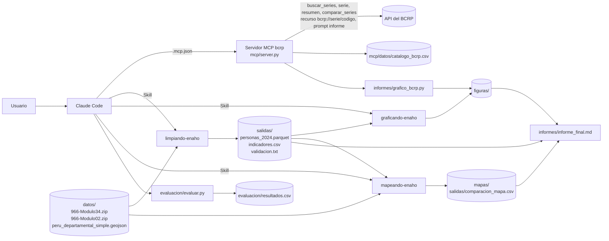
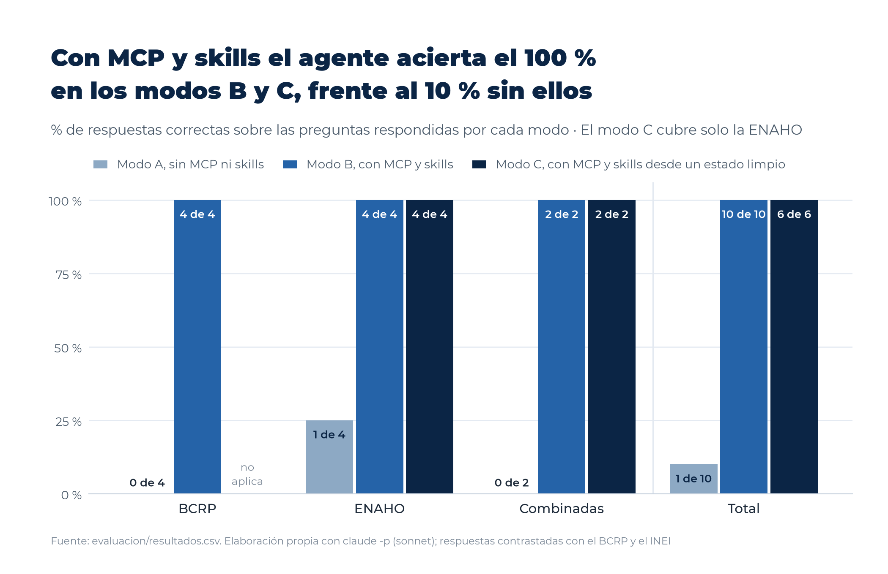

# Agente de investigación sobre pobreza monetaria y contexto macroeconómico en el Perú

Proyecto correspondiente a la 2026_Tarea_4 del curso Data Science con Python (issue #201 de d2cml-ai/Data-Science-Python), con seguimiento en el issue #33 de este repositorio, desarrollado en la carpeta `tarea_8` y en la rama `tarea-8-agente-bcrp-enaho`.

## 1. Objetivo del proyecto

El proyecto construye un agente de investigación sobre Claude Code que combina un servidor MCP propio, con acceso a las series oficiales del Banco Central de Reserva del Perú (BCRP), y tres skills que procesan los microdatos de la Encuesta Nacional de Hogares (ENAHO) 2024 del Instituto Nacional de Estadística e Informática (INEI). El agente se emplea para responder una pregunta de investigación sobre la configuración de la pobreza monetaria en 2024 según departamento, área de residencia y sexo, en el contexto de la inflación y del crecimiento económico entre 2019 y 2024, cuyos resultados se presentan en [`informes/informe_final.md`](informes/informe_final.md). Asimismo, el proyecto evalúa de manera reproducible si el servidor MCP y las skills mejoran la exactitud de las respuestas frente a un modelo sin herramientas.

**Pregunta de investigación.** ¿Cómo se configuró la pobreza monetaria en el Perú en 2024 según departamento, área de residencia y sexo, en un contexto macroeconómico marcado por la evolución de la inflación y del crecimiento económico entre 2019 y 2024?

**Hallazgos principales.** En primer lugar, la pobreza monetaria alcanzó al 27.6 % de la población en 2024 y presentó una marcada heterogeneidad territorial, con una distancia de 39.0 puntos porcentuales entre Cajamarca (45.0 %) e Ica (6.0 %). En segundo lugar, la pobreza rural (39.3 %) superó a la urbana (24.8 %) en 14.5 puntos porcentuales, en tanto que las diferencias por sexo fueron reducidas, de 27.7 % en las mujeres frente a 27.4 % en los hombres, y no superaron 1.2 puntos porcentuales dentro de ninguna área. En tercer lugar, el contexto de 2019 a 2024 combinó la contracción del PBI de 10.9 % en 2020, el rebote de 2021 y un episodio inflacionario que alcanzó 8.8 % en junio de 2022, antes de que 2024 cerrara con un crecimiento de 3.5 % y una inflación de 2.0 %, si bien la correlación entre ambas series fue débil (0.23) y no autoriza conclusiones causales.

## 2. Arquitectura general del agente

Claude Code actúa como orquestador. Las cifras macroeconómicas se obtienen del servidor MCP `bcrp`, que consulta la API oficial del BCRP y efectúa los cálculos en Python, mientras que las cifras de pobreza se obtienen de las skills, que leen los microdatos de `datos/`, escriben sus resultados en `salidas/`, `figuras/` y `mapas/`, y validan cada cifra frente a las publicaciones oficiales. El informe final y la evaluación se construyen a partir de esos productos.



## 3. Herramientas del servidor MCP

El servidor se define en [`mcp/server.py`](mcp/server.py) con FastMCP y expone cuatro herramientas de solo lectura, un recurso y un prompt. Todas las cifras proceden de la API oficial del BCRP, y las variaciones, promedios, extremos y correlaciones se calculan en Python, de modo que el modelo no efectúa cuentas a mano. Las fechas aceptan los formatos `2025`, `2025-T1`, `2025-01` y `2026-10-01`, con independencia de la frecuencia de la serie.

| Componente | Tipo | Argumentos | Función | Ejemplo de uso |
|---|---|---|---|---|
| `buscar_series` | Herramienta | `texto`, `frecuencia` (opcional, Diaria, Mensual, Trimestral o Anual), `limite` (por defecto 10) | Busca en el catálogo oficial las series cuyo nombre, grupo o categoría contienen todas las palabras indicadas, y devuelve el código, el nombre, la frecuencia, el inicio y la fecha de actualización | `buscar_series(texto="ipc 12 meses", frecuencia="Mensual")` devuelve PN01273PM |
| `serie` | Herramienta | `codigo`, `desde`, `hasta` | Descarga los valores de una serie período a período, con la URL consultada | `serie(codigo="PN01273PM", desde="2026-09", hasta="2026-10")` devuelve 4.55 y 5.25 |
| `resumen` | Herramienta | `codigo`, `desde`, `hasta` | Calcula el primer y el último valor, el cambio absoluto, la variación porcentual, el promedio y los extremos con su periodo | `resumen(codigo="PN01273PM", desde="2019-01", hasta="2024-12")` devuelve un máximo de 8.81 en 2022-06 |
| `comparar_series` | Herramienta | `codigo_a`, `codigo_b`, `desde`, `hasta` | Alinea dos series en una frecuencia común, promediando la más frecuente, y calcula su correlación de Pearson | `comparar_series(codigo_a="PN01273PM", codigo_b="PM04923AA", desde="2019", hasta="2024")` devuelve una correlación de 0.2323 |
| `bcrp://serie/{codigo}` | Recurso | `codigo` | Devuelve la ficha de una serie, con su nombre, categoría, frecuencia, inicio, fecha de actualización y enlaces a la página oficial y a la API, sin valores | `@bcrp:bcrp://serie/PN01273PM` en el mensaje de Claude Code |
| `informe` | Prompt | `tema` | Solicita un informe breve basado solo en series del BCRP, con cada cifra citada mediante código, periodo y fuente, y con una tabla final de fuentes | `/mcp__bcrp__informe "tipo de cambio interbancario en 2026"` |

## 4. Skills del proyecto

Las tres skills se ubican en `.claude/skills/` y siguen las convenciones de la Sesión 16 del curso. Cada una ejecuta un script de Python con `uv run` y se detiene con un mensaje `ERROR` cuando falta un insumo o falla una verificación, sin completar cifras a mano.

| Skill | Función | Entradas | Salidas |
|---|---|---|---|
| [`limpiando-enaho`](.claude/skills/limpiando-enaho/SKILL.md) | Une los módulos 34 (sumaria) y 02 (miembros del hogar), filtra a los residentes habituales, valida la pobreza oficial y calcula los indicadores nacionales, por área, dominio, departamento, sexo y grupo de edad | `datos/966-Modulo34.zip` y `datos/966-Modulo02.zip`, con el argumento opcional `--anio` | `salidas/personas_2024.parquet`, `salidas/indicadores.csv` y `salidas/validacion.txt` |
| [`graficando-enaho`](.claude/skills/graficando-enaho/SKILL.md) | Elabora gráficos de barras de la pobreza con factores de expansión y el estilo del proyecto (Montserrat y escala de azules) | `salidas/personas_2024.parquet` y el argumento `--indicador` (`area`, `sexo`, `edad`, `departamento`, `sexo_area` o `todos`) | `figuras/pobreza_<indicador>.png` |
| [`mapeando-enaho`](.claude/skills/mapeando-enaho/SKILL.md) | Elabora el mapa coroplético departamental con el método oficial y lo contrasta con la referencia del curso | `salidas/personas_2024.parquet`, `datos/peru_departamental_simple.geojson` y `referencias/pobreza_departamento_2024.csv` | `mapas/pobreza_departamento.png` y `salidas/comparacion_mapa.csv` |

**Activación.** Las skills se activan de forma automática cuando la petición coincide con su descripción, por ejemplo «Haz un mapa de la pobreza monetaria por departamento con ENAHO 2024», o de forma manual mediante su nombre, como en `/limpiando-enaho 2024` o `/graficando-enaho sexo_area`. En modo no interactivo, el agente las invoca mediante la herramienta `Skill`.

**Coordinación.** La skill `limpiando-enaho` constituye el primer eslabón, ya que produce la base de personas que requieren las otras dos. Por ello, `graficando-enaho` y `mapeando-enaho` comprueban la existencia de `salidas/personas_2024.parquet` y, si no existe, remiten a `limpiando-enaho`. Además, ambas comparten el módulo de estilo `graficando-enaho/scripts/estilo.py` y el mismo criterio de cálculo, según el cual los indicadores de nivel hogar emplean el método oficial del INEI y los atributos individuales emplean el método de personas.

## 5. Fuentes y descarga de los datos

| Fuente | Archivo | Enlace de descarga |
|---|---|---|
| INEI, ENAHO 2024, módulo 34 (sumaria) | `datos/966-Modulo34.zip` | https://proyectos.inei.gob.pe/iinei/srienaho/descarga/STATA/966-Modulo34.zip |
| INEI, ENAHO 2024, módulo 02 (características de los miembros del hogar) | `datos/966-Modulo02.zip` | https://proyectos.inei.gob.pe/iinei/srienaho/descarga/STATA/966-Modulo02.zip |
| Límites departamentales del Perú (Sesión 06 del curso) | `datos/peru_departamental_simple.geojson` | https://raw.githubusercontent.com/d2cml-ai/Data-Science-Python/main/sessions/06-geoespacial/lab/Data/peru_departamental_simple.geojson |
| BCRP, catálogo de series | `mcp/datos/catalogo_bcrp.csv`, descargado por el servidor la primera vez | https://estadisticas.bcrp.gob.pe/estadisticas/series/metadata |
| BCRP, API de series estadísticas | Consultada en línea por el servidor MCP | https://estadisticas.bcrp.gob.pe/estadisticas/series/api/ |
| INEI, portal de microdatos (código 966 para la ENAHO 2024) | Consulta de la documentación y descarga alternativa | https://proyectos.inei.gob.pe/microdatos/ |

El código 966 corresponde a la ENAHO 2024 en el portal de microdatos del INEI. Los archivos se colocan en `datos/` sin descomprimir. La carpeta `datos/` no se versiona, según lo dispuesto en `.gitignore`, que también excluye `salidas/*.parquet` por su tamaño, de modo que ambos deben regenerarse localmente.

## 6. Instalación

El proyecto utiliza el gestor de entornos uv y Python 3.12, fijado en `.python-version`. Desde la carpeta `tarea_8` se instala el entorno con las versiones exactas de `uv.lock`.

```
cd tarea_8
uv sync
```

Las dependencias principales son `fastmcp`, `httpx`, `pandas`, `pyarrow`, `geopandas` y `matplotlib`, además de `pytest` en el grupo de desarrollo.

## 7. Conexión del servidor MCP a Claude Code

El servidor se registra a nivel de proyecto en el archivo `.mcp.json`, que Claude Code lee al abrir la carpeta `tarea_8`.

```json
{
  "mcpServers": {
    "bcrp": {
      "command": "uv",
      "args": ["run", "mcp/server.py"]
    }
  }
}
```

El mismo archivo puede generarse con la orden siguiente.

```
claude mcp add --scope project bcrp -- uv run mcp/server.py
```

Al abrir Claude Code en `tarea_8` se aprueba el servidor del proyecto, y luego la orden `/mcp` permite verificar que `bcrp` figura como conectado, con sus cuatro herramientas, el recurso de fichas de series descrito en la sección 3 y el prompt `informe`.

## 8. Reproducción

Los comandos se ejecutan desde la carpeta `tarea_8`, una vez descargados los datos de la sección 5.

```
# Procesamiento de la ENAHO y validación frente a las cifras oficiales
uv run .claude/skills/limpiando-enaho/scripts/limpiar.py --anio 2024

# Gráficos de pobreza (area, sexo, edad, departamento, sexo_area o todos)
uv run .claude/skills/graficando-enaho/scripts/graficar.py --indicador todos

# Mapa departamental y comparación con la referencia del curso
uv run .claude/skills/mapeando-enaho/scripts/mapear.py

# Gráfico de la inflación del BCRP, obtenido a través del servidor MCP
uv run informes/grafico_bcrp.py

# Pruebas del servidor MCP (resultado esperado, 10 passed)
uv run pytest -q

# Evaluación del agente, modos A y B, y experimento complementario del modo C
uv run evaluacion/evaluar.py
uv run evaluacion/evaluar.py --modos C

# Recalificación desde los registros guardados, sin llamar al modelo, y figura de la evaluación
uv run evaluacion/evaluar.py --recalificar
uv run evaluacion/grafico_evaluacion.py
```

La evaluación requiere la interfaz `claude` instalada y autenticada, dado que cada pregunta se formula mediante `claude -p`.

## 9. Resultados de la evaluación

La evaluación formuló diez preguntas con respuesta oficial conocida, cuatro del BCRP, cuatro de la ENAHO y dos combinadas, en tres modos. El modo A operó sin MCP ni skills, el modo B dispuso de ambos desde `tarea_8`, y el modo C, complementario, repitió las seis preguntas que involucran la ENAHO desde una copia limpia del proyecto, sin resultados precalculados ni archivos de referencia.

| Modo | Preguntas | Aciertos | Se equivoca | No sabe | Porcentaje de aciertos | Tiempo promedio (s) |
|---|---|---|---|---|---|---|
| A, sin MCP ni skills | 10 | 1 | 1 | 8 | 10 % | 6.9 |
| B, con MCP y skills | 10 | 10 | 0 | 0 | 100 % | 16.3 |
| C, con MCP y skills desde un estado limpio | 6 | 6 | 0 | 0 | 100 % | 16.7 |



El servidor MCP permitió responder con exactitud todas las preguntas del BCRP, que el modelo sin herramientas no pudo contestar. En el modo B, el agente respondió las preguntas de la ENAHO mediante la lectura de resultados ya generados, mientras que en el modo C invocó la skill `limpiando-enaho` en cuatro de las seis preguntas, procesó los microdatos y alcanzó la misma exactitud. El análisis completo, con las preguntas, los errores y las herramientas usadas en cada caso, se encuentra en [`evaluacion/comparacion.md`](evaluacion/comparacion.md), y los datos en [`evaluacion/resultados.csv`](evaluacion/resultados.csv).

## 10. Limitaciones y problemas encontrados

**Método oficial frente al método de personas.** Los indicadores de nivel hogar (nacional, área, dominio y departamento) se calculan con el método oficial del INEI, que pondera una fila por hogar de la sumaria con `factor07 × mieperho`, mientras que los atributos individuales (sexo, grupo de edad y sexo según área) exigen la base de personas ponderada con `facpob07`. Ambos métodos coinciden a escala nacional (27.58 % y 27.53 %), pero solo el oficial reproduce al decimal la pobreza de los 25 departamentos, frente a seis con el método de personas, debido a que en 1 846 hogares el número de miembros de la sumaria difiere del de residentes habituales.

**Fecha de actualización del catálogo del BCRP.** La fecha de actualización que consigna el catálogo no refleja el último periodo publicado. La serie PN01273PM figura actualizada al 8 de octubre de 2026, pese a lo cual la API devolvió el dato de octubre de 2026, publicado con posterioridad, de manera que dicha fecha no debe interpretarse como el último periodo con datos.

**Aislamiento incompleto del modo C.** La copia limpia excluyó `salidas/` y las referencias departamentales, pero la validación interna de `limpiar.py` muestra las cifras nacionales y por área publicadas por el INEI, por lo que el agente pudo observar algunas cifras de contraste. Asimismo, sin la carpeta `referencias/` el script de `mapeando-enaho` no puede completarse, aunque esta skill no fue necesaria para responder. En el modo B, por su parte, Claude Code aprobó de forma automática las órdenes de solo lectura de `Bash`, de modo que la restricción a `uv run` no impidió leer archivos ya generados.

**Nombre de la carpeta.** El proyecto corresponde a la Tarea 4 del curso, pero se desarrolló en la carpeta `tarea_8` porque `tarea_4/` ya estaba ocupada en el repositorio, lo que el enunciado permite.

**Alcance de la evaluación.** Cada pregunta se formuló una sola vez por modo y con un único modelo, de manera que los resultados no recogen la variabilidad entre ejecuciones.

## 11. Ejemplo de ejecución completa

La ejecución integrada registrada en [`evidencias_ia/integracion/02_ejecucion_integrada.txt`](evidencias_ia/integracion/02_ejecucion_integrada.txt) respondió, en una única sesión de Claude Code, la pregunta de investigación del informe final. La petición solicitó invocar las skills mediante la herramienta `Skill`, consultar el servidor MCP con sus cuatro herramientas, regenerar la figura del BCRP y contrastar cada cifra con el informe. La secuencia registrada fue la siguiente.

| Paso | Herramienta | Argumentos principales | Resultado |
|---|---|---|---|
| 1 | Skill `limpiando-enaho` | `--anio 2024` | 108 664 personas en 33 691 hogares, con todas las verificaciones en `[OK]` y una pobreza nacional de 27.58 % |
| 2 a 4 | Skill `graficando-enaho` | `area`, `sexo` y `sexo_area` | Pobreza rural de 39.3 % y urbana de 24.8 %, de 27.7 % en mujeres y 27.4 % en hombres, y de 40.0 % y 38.8 % en mujeres y hombres rurales |
| 5 | Skill `mapeando-enaho` | Sin argumentos | 25 de 25 departamentos coincidentes con la referencia, con Cajamarca (45.0 %) e Ica (6.0 %) en los extremos |
| 6 y 7 | MCP `buscar_series` | IPC de Lima Metropolitana y PBI por tipo de gasto | Series PN01273PM y PM04923AA |
| 8 y 9 | MCP `resumen` | 2019 a 2024 | Inflación promedio de 4.08 %, con máximo de 8.81 % en junio de 2022, y crecimiento promedio del PBI de 1.78 % |
| 10 y 11 | MCP `serie` | PM04923AA 2019 a 2024 y PN01273PM 2026-09 a 2026-10 | Crecimiento anual del PBI e inflación de 4.55 % y 5.25 % |
| 12 | MCP `comparar_series` | PN01273PM frente a PM04923AA, 2019 a 2024 | Correlación de 0.2323 entre los promedios anuales |
| 13 | `uv run informes/grafico_bcrp.py` | PN01273PM, 2019-01 a 2024-12 | Figura `figuras/bcrp_inflacion_2019_2024.png` regenerada |

Todas las cifras coincidieron al decimal con las de [`informes/informe_final.md`](informes/informe_final.md), por lo que el informe no requirió modificaciones.

## 11 bis. Innovaciones incorporadas

El proyecto incorpora varias de las ideas de innovación propuestas en el enunciado, además de un análisis complementario de carácter interseccional. La tabla siguiente identifica cada una y el archivo donde se documenta.

| Innovación | Descripción | Documentación |
|---|---|---|
| Pruebas de robustez frente a datos inexistentes | Se formularon tres consultas de prueba, una serie inexistente del BCRP, un periodo aún no publicado y un departamento inexistente en la ENAHO, y en los tres casos el agente informó el error recibido sin inventar cifras | Apartado «Manejo de errores» de la sección 7 de [`informes/informe_final.md`](informes/informe_final.md) y [`evidencias_ia/integracion/03_verificacion_y_errores.txt`](evidencias_ia/integracion/03_verificacion_y_errores.txt) |
| Efecto de desactivar herramientas | Las mismas preguntas se formularon sin MCP ni skills (modo A), con ambos desde el proyecto (modo B) y con ambos desde una copia limpia sin resultados precalculados (modo C), lo que permitió aislar la contribución de cada componente | [`evaluacion/comparacion.md`](evaluacion/comparacion.md), [`evaluacion/resultados.csv`](evaluacion/resultados.csv) y [`figuras/evaluacion_modos.png`](figuras/evaluacion_modos.png) |
| Detección de inconsistencias entre métodos y herramientas | El método oficial del INEI se contrastó con el método de personas, que coincide a escala nacional pero solo en seis departamentos, el mapa se contrastó con la referencia departamental del curso, con 25 coincidencias de 25, y cada cifra de la ejecución integrada se contrastó con las del informe final | [`salidas/validacion.txt`](salidas/validacion.txt), [`salidas/comparacion_mapa.csv`](salidas/comparacion_mapa.csv) y [`evidencias_ia/integracion/02_ejecucion_integrada.txt`](evidencias_ia/integracion/02_ejecucion_integrada.txt) |
| Generación de informes con tablas, gráficos y referencias | El prompt `informe` del servidor MCP solicita informes breves con cada cifra citada mediante código, periodo y fuente, y con una tabla final de fuentes, mientras que el script `informes/grafico_bcrp.py` elabora gráficos con datos obtenidos del mismo servidor | [`mcp/server.py`](mcp/server.py), [`evidencias_ia/mcp/02_demostracion_mcp.txt`](evidencias_ia/mcp/02_demostracion_mcp.txt) y [`informes/grafico_bcrp.py`](informes/grafico_bcrp.py) |
| Análisis interseccional complementario | La pobreza se examinó conjuntamente por sexo y área de residencia, lo que mostró una brecha entre mujeres y hombres mayor en el área rural (1.2 puntos porcentuales) que en la urbana (0.2 puntos porcentuales), interpretada a la luz del marco conceptual del informe | [`figuras/pobreza_sexo_area.png`](figuras/pobreza_sexo_area.png), hallazgo 3 y marco conceptual de [`informes/informe_final.md`](informes/informe_final.md) |

## 12. Evidencias de IA

La carpeta `evidencias_ia/` contiene las exportaciones en texto de las sesiones de Claude Code y sus registros originales.

| Archivo | Parte que cubre |
|---|---|
| [`evidencias_ia/mcp/01_servidor_mcp.txt`](evidencias_ia/mcp/01_servidor_mcp.txt) | Parte 1, preparación del proyecto y desarrollo del servidor MCP con sus pruebas |
| [`evidencias_ia/mcp/02_demostracion_mcp.txt`](evidencias_ia/mcp/02_demostracion_mcp.txt) | Parte 1, demostración del servidor MCP con sus herramientas, el recurso y el prompt |
| [`evidencias_ia/skills/01_desarrollo_skills.txt`](evidencias_ia/skills/01_desarrollo_skills.txt) | Parte 2, desarrollo y ajuste de las tres skills |
| [`evidencias_ia/skills/02_activacion_skills.txt`](evidencias_ia/skills/02_activacion_skills.txt) | Parte 2, activación automática y manual de las skills |
| [`evidencias_ia/integracion/01_agente_investigacion.txt`](evidencias_ia/integracion/01_agente_investigacion.txt) | Parte 3, agente de investigación y redacción del informe final |
| [`evidencias_ia/integracion/02_ejecucion_integrada.txt`](evidencias_ia/integracion/02_ejecucion_integrada.txt) | Parte 3, ejecución integrada de las skills y del servidor MCP en una sola sesión |
| [`evidencias_ia/integracion/03_verificacion_y_errores.txt`](evidencias_ia/integracion/03_verificacion_y_errores.txt) | Parte 3, pruebas de manejo de errores (serie inexistente, periodo futuro y departamento inexistente) y ajustes finales del informe y del README |
| [`evidencias_ia/evaluacion/01_evaluacion_agente.txt`](evidencias_ia/evaluacion/01_evaluacion_agente.txt) | Parte 4, diseño y ejecución de la evaluación en los modos A, B y C |
| [`evidencias_ia/evaluacion/02_readme_y_cierre.txt`](evidencias_ia/evaluacion/02_readme_y_cierre.txt) | Parte 4, redacción del README, corrección de la figura de evaluación y limpieza final |
| [`evidencias_ia/historial_completo/`](evidencias_ia/historial_completo/LEEME.md) | Registros originales `.jsonl` de las cuatro sesiones, con datos sensibles ocultados, descritos en su archivo `LEEME.md` |
