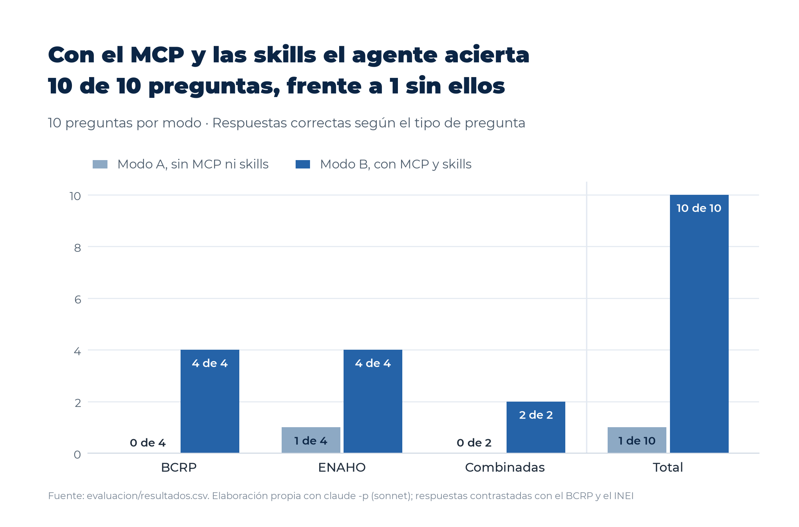

# Evaluación del agente con y sin el servidor MCP y las skills

## 1. Objetivo y diseño

La presente evaluación examina si el acceso al servidor MCP del BCRP y a las skills de la ENAHO mejora la exactitud de las respuestas del agente frente a un modelo que responde únicamente con su conocimiento previo. El diseño adapta el archivo `evaluar.py` de la Sesión 04 del curso, de modo que cada una de las diez preguntas de `evaluacion/preguntas.csv` se formuló a Claude Code en modo no interactivo, en una sesión independiente y sin persistencia, con el mismo modelo (`sonnet`) y con la misma instrucción en ambos modos. La instrucción solicitó un objeto JSON con los campos `valor`, `valor_2`, `unidad`, `fuente` e `interpretacion`, y pidió devolver `null` en lugar de estimar cuando la cifra no pudiera conocerse con certeza.

Las preguntas se distribuyen en cuatro del BCRP, cuatro de la ENAHO y dos combinadas, que exigen una cifra de cada fuente. Las respuestas esperadas proceden de fuentes oficiales independientes del agente, se fijaron antes de la ejecución y no se modificaron después de observar los resultados. Antes del experimento se verificaron los dos valores del BCRP de las preguntas combinadas mediante consultas directas a la API oficial, sin intervención del servidor MCP, y ambos coincidieron con lo esperado dentro de la tolerancia, puesto que el PBI real de 2024 fue 3.5153 % y la inflación de diciembre de 2024 fue 1.9663 %. Las direcciones consultadas figuran en la columna `fuente_verificacion`.

## 2. Herramientas habilitadas en cada modo

| Modo | Carpeta de ejecución | Opciones de `claude -p` | Herramientas habilitadas según el evento `init` |
|---|---|---|---|
| Ambos | Según el modo | `--model sonnet`, `--no-session-persistence`, `--output-format stream-json --verbose`, `--json-schema` con los cinco campos | Según el modo |
| A, sin MCP ni skills | Carpeta temporal vacía, creada fuera del repositorio en cada llamada | `--tools ""`, `--strict-mcp-config` | Ninguna (solo la herramienta interna `StructuredOutput`, que entrega el JSON) |
| B, con MCP y skills | `tarea_8` | `--mcp-config .mcp.json`, `--strict-mcp-config`, `--tools "Skill,Read,Bash"`, `--allowedTools "mcp__bcrp,Skill,Read,Bash(uv run:*)"` | `Bash`, `Read`, `Skill`, `mcp__bcrp__buscar_series`, `mcp__bcrp__resumen`, `mcp__bcrp__serie` y `mcp__bcrp__comparar_series`, con el servidor `bcrp` conectado y las skills `limpiando-enaho`, `graficando-enaho` y `mapeando-enaho` disponibles |

Ambos modos produjeron una salida en formato `stream-json` con registro detallado, lo que permitió registrar las herramientas habilitadas y las efectivamente usadas. En `resultados.csv` una herramienta figura como usada solo si su llamada se completó sin error, mientras que las llamadas denegadas por permisos o rechazadas se consignan en la columna `herramientas_fallidas`. Los registros completos de cada llamada se conservan en `evaluacion/registros/`.

## 3. Criterio de corrección

El criterio se definió antes de ejecutar el experimento y consta en la columna `criterio` de `preguntas.csv` y en el encabezado de `evaluar.py`. En las preguntas simples, una respuesta acierta si el valor se encuentra dentro de la tolerancia, se clasifica como «no sabe» si el valor es `null` y como «se equivoca» en cualquier otro caso. En las preguntas combinadas, la respuesta acierta si ambos valores se encuentran dentro de su tolerancia y la interpretación no afirma causalidad. Se considera que la interpretación afirma causalidad cuando contiene una expresión causal no negada, como «causó», «se debe a», «contribuyó» o «impulsó», según la lista fijada en `evaluar.py`. Si algún valor queda fuera de la tolerancia o la interpretación afirma causalidad, la respuesta se equivoca, y si ninguna de esas condiciones se cumple pero algún valor es `null`, se clasifica como «no sabe».

## 4. Resultados

| Pregunta | Tipo | Esperado | Modo A | Resultado A | Modo B | Resultado B | Herramientas usadas en B |
|---|---|---|---|---|---|---|---|
| bcrp_1 | BCRP | 5.2510 | null | no sabe | 5.25 | acierta | `buscar_series` (2) y `serie` |
| bcrp_2 | BCRP | 4.25 | null | no sabe | 4.25 | acierta | `buscar_series` y `serie` |
| bcrp_3 | BCRP | 3.4282 | null | no sabe | 3.4282 | acierta | `buscar_series` y `serie` |
| bcrp_4 | BCRP | 3.4306 | null | no sabe | 3.43 | acierta | `buscar_series` (2) y `serie` |
| enaho_1 | ENAHO | 27.6 | 27.6 | acierta | 27.6 | acierta | Ninguna |
| enaho_2 | ENAHO | 39.3 | null | no sabe | 39.3 | acierta | `Bash` de lectura (2), sobre `salidas/indicadores.csv` |
| enaho_3 | ENAHO | 45.0 | null | no sabe | 45.0 | acierta | `Bash` de lectura (2), sobre `salidas/comparacion_mapa.csv` |
| enaho_4 | ENAHO | 6.0 | null | no sabe | 6.0 | acierta | `Bash` de lectura (2), sobre la referencia y `salidas/comparacion_mapa.csv` |
| combinada_1 | Combinada | 27.6 y 3.52 | 27.6 y 3.3 | se equivoca | 27.6 y 3.5 | acierta | `buscar_series` y `serie` |
| combinada_2 | Combinada | 14.5 y 1.97 | null y 1.97 | no sabe | 14.49 y 1.97 | acierta | `buscar_series` (2), `serie` y `Bash` de lectura (2) |

| Modo | Aciertos | Se equivoca | No sabe | Tiempo promedio (s) | Turnos promedio | Herramientas usadas por pregunta |
|---|---|---|---|---|---|---|
| A, sin MCP ni skills | 1 de 10 | 1 | 8 | 6.9 | 2.0 | 0.0 |
| B, con MCP y skills | 10 de 10 | 0 | 0 | 16.3 | 4.9 | 2.3 |

*Figura 6.* Número de respuestas correctas por modo y por tipo de pregunta. Fuente. Elaboración propia con `evaluacion/resultados.csv`.

El modo B respondió correctamente las diez preguntas, mientras que el modo A acertó únicamente una, correspondiente a la pobreza monetaria nacional de 2024, cifra que el modelo recordó de la publicación del INEI. En el modo A, ocho respuestas se clasificaron como «no sabe» y una como «se equivoca». Ninguna respuesta del modo B quedó sin valor ni fuera de la tolerancia, y ninguna interpretación de las preguntas combinadas afirmó causalidad en ninguno de los dos modos.

El tiempo promedio de ejecución fue de 6.9 segundos en el modo A y de 16.3 segundos en el modo B, es decir, alrededor de 2.4 veces mayor en este último. El aumento obedece a las consultas al servidor MCP y a la lectura de archivos del proyecto, que elevaron el número promedio de turnos de 2.0 a 4.9. Las preguntas combinadas fueron las más costosas en el modo B, con un promedio de 24.2 segundos, y la pregunta combinada_2 alcanzó el máximo de 32.3 segundos, debido a que requirió consultas a ambas fuentes.

## 5. Preguntas que mejoraron o empeoraron

Nueve de las diez preguntas mejoraron al pasar del modo A al modo B. Las cuatro preguntas del BCRP, las tres preguntas departamentales o por área de la ENAHO (enaho_2, enaho_3 y enaho_4) y la pregunta combinada_2 pasaron de «no sabe» a «acierta», en tanto que la pregunta combinada_1 pasó de «se equivoca» a «acierta». La pregunta enaho_1 se respondió correctamente en ambos modos, y ninguna pregunta empeoró.

## 6. Principales errores

En el modo A predominó la abstención y no la invención de cifras. El modelo declaró en ocho casos que no podía confirmar el dato y devolvió `null`, conforme a la instrucción, lo que indica una calibración adecuada frente a cifras recientes, como las de 2026, o de alto detalle, como las departamentales. El único error propiamente dicho se produjo en la pregunta combinada_1, en la que el modelo informó un crecimiento del PBI real de 3.3 % para 2024, frente al 3.52 % oficial, pese a reconocer en el campo `fuente` que la cifra provenía de su memoria y no había sido verificada. En la pregunta combinada_2, el modelo recordó correctamente la inflación de diciembre de 2024 (1.97 %), pero se abstuvo de calcular la brecha de pobreza, por lo que la respuesta se clasificó como «no sabe».

En el modo B no se registraron respuestas incorrectas, aunque el análisis de los registros revela cuatro desviaciones de procedimiento que matizan el resultado. En primer lugar, el agente no invocó ninguna skill mediante la herramienta `Skill` en ninguna de las diez preguntas. Las cifras de la ENAHO se obtuvieron mediante la lectura de archivos ya generados por las skills en sesiones previas, como `salidas/indicadores.csv` y `salidas/comparacion_mapa.csv`, de manera que el modo B aprovechó los productos de las skills, pero no su ejecución. En segundo lugar, la autorización de `Bash` limitada a las órdenes `uv run` no impidió el uso de comandos de solo lectura, dado que Claude Code aprueba de forma automática órdenes como `grep`, `cat`, `head` o `ls` dentro de la carpeta de trabajo. Se completaron así ocho llamadas a `Bash` ajenas a `uv run`, mientras que seis llamadas fueron rechazadas, cinco de ellas por intentar operar fuera de `tarea_8` y una por invocar la herramienta `Grep`, que no estaba habilitada. En la práctica, este acceso equivale al que ya otorgaba la herramienta `Read`, aunque no se ajusta estrictamente a la configuración prevista.

En tercer lugar, la disponibilidad de herramientas no garantizó su uso, puesto que en la pregunta enaho_1 y en el componente de pobreza de la pregunta combinada_1 el agente respondió de memoria, sin consultar archivos ni ejecutar skills, y declaró en el campo `fuente` que la cifra no había sido verificada. Ambas respuestas resultaron correctas, pero su exactitud no deriva de las herramientas. En cuarto lugar, en la pregunta enaho_4 el agente leyó el archivo de referencia de la Sesión 16, que coincide con la fuente de verificación de la respuesta esperada, por lo que ese acierto no es independiente de la fuente de contraste, si bien el mismo archivo `salidas/comparacion_mapa.csv`, generado con la skill `mapeando-enaho`, consignaba el valor correcto de 6.01 %. Por último, la búsqueda en el catálogo del BCRP resultó sensible a la redacción de la consulta, ya que en tres preguntas la primera llamada a `buscar_series` no devolvió resultados y el agente debió reformularla, y en la pregunta combinada_1 el agente empleó la serie PM04983AA, del PBI por sectores productivos, en lugar de la serie PM04923AA, del PBI por tipo de gasto, aunque ambas registran el mismo crecimiento para 2024.

## 7. Limitaciones

La evaluación se basa en una sola ejecución por pregunta y modo, con un total de diez preguntas, de modo que los resultados no permiten estimar la variabilidad propia de un modelo de lenguaje y podrían diferir en ejecuciones sucesivas. Asimismo, el experimento empleó un único modelo, y los tiempos registrados incluyen el arranque de cada sesión y, en el modo B, el del servidor MCP, además de que las llamadas del modo A se ejecutaron en paralelo con las del modo B. Finalmente, la detección de afirmaciones causales se basa en una lista cerrada de expresiones, por lo que podría omitir formulaciones causales implícitas.

## 8. Conclusión

Los resultados indican que el servidor MCP del BCRP constituye el componente de mayor utilidad del agente. Las cuatro preguntas del BCRP y los componentes macroeconómicos de las preguntas combinadas, que el modelo no podía responder sin herramientas, se resolvieron con exactitud mediante `buscar_series` y `serie`, con indicación explícita del código y del periodo de cada serie. En lo que respecta a la ENAHO, el modo B acertó todas las preguntas, pero lo hizo mediante la lectura de los resultados que las skills habían producido con anterioridad y no mediante su invocación, de manera que la evaluación demuestra la utilidad de los productos validados de las skills, aunque no la activación autónoma de estas en modo no interactivo. Por consiguiente, el MCP y las skills elevan la exactitud del agente de una a diez respuestas correctas, a cambio de un tiempo de ejecución 2.4 veces mayor, mientras que el modelo sin herramientas tiende, de manera prudente, a abstenerse antes que a inventar cifras, con una sola excepción. Una evaluación posterior debería restringir el acceso a los archivos de `salidas/` y bloquear los comandos de lectura de `Bash`, con el fin de medir de forma aislada la contribución de la ejecución de las skills.
