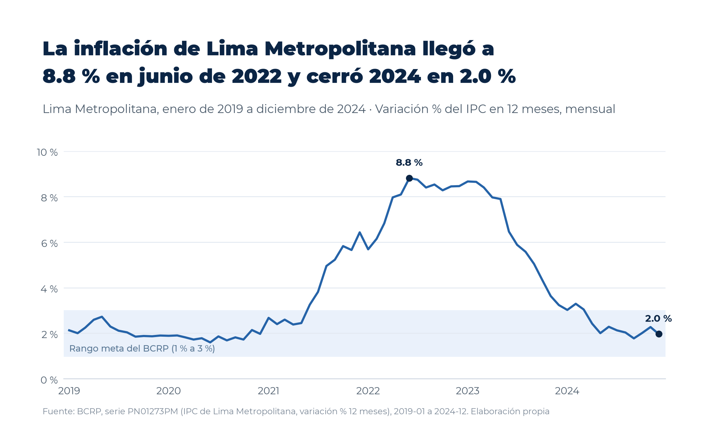
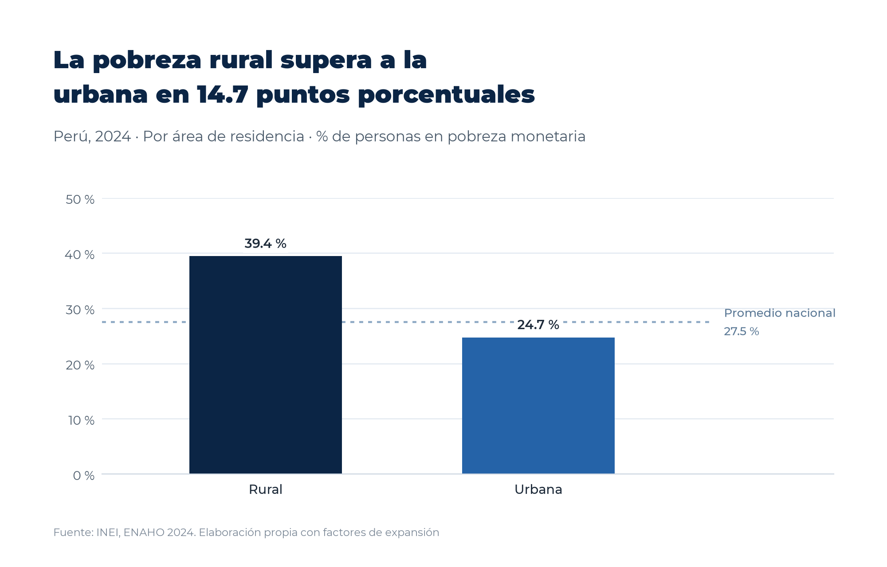
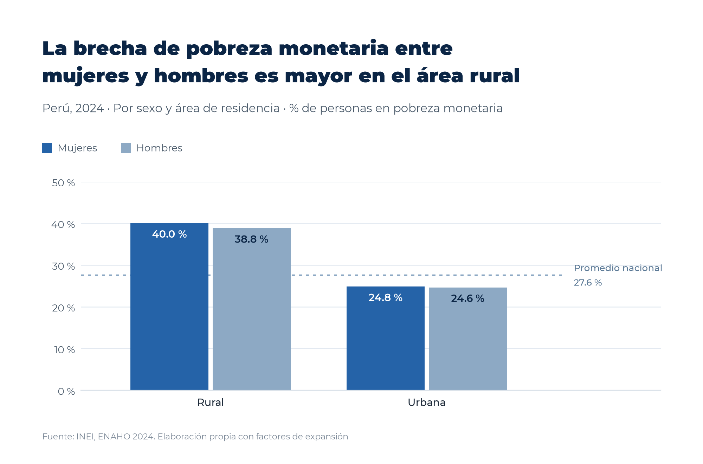
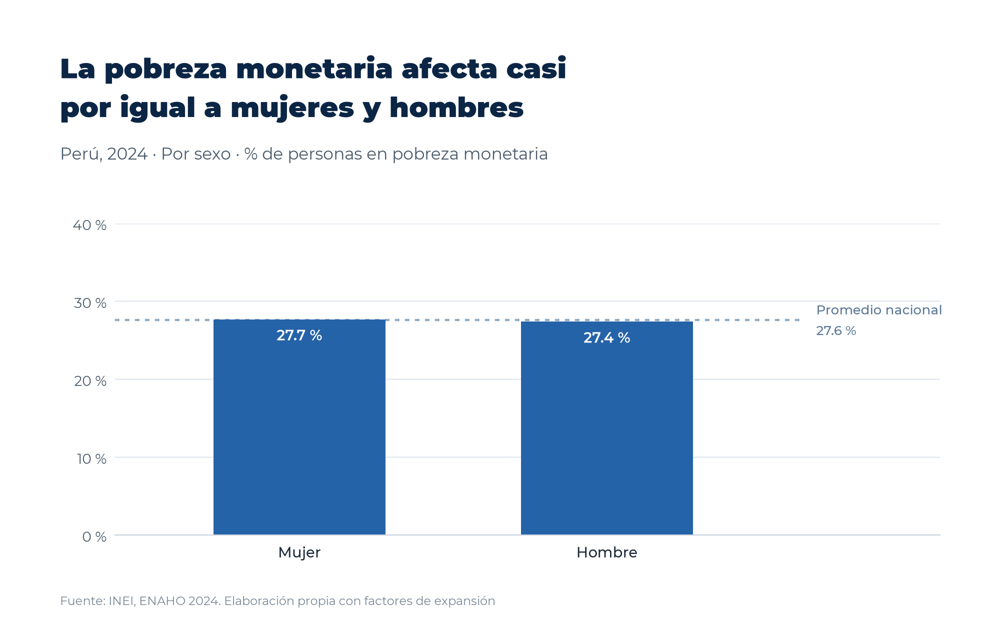
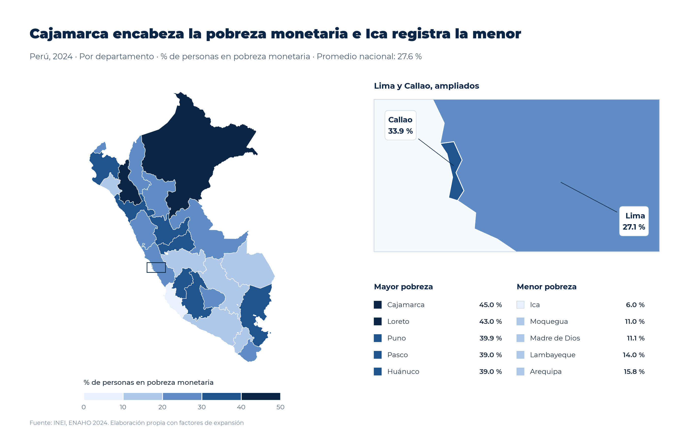

# La pobreza monetaria en el Perú en 2024 y su contexto macroeconómico entre 2019 y 2024

## 1. Pregunta de investigación

**Pregunta.** ¿Cómo se configuró la pobreza monetaria en el Perú en 2024 según departamento, área de residencia y sexo, en un contexto macroeconómico marcado por la evolución de la inflación y del crecimiento económico entre 2019 y 2024?

**Tema.** El presente informe aborda la distribución territorial y demográfica de la pobreza monetaria en el Perú, en relación con la trayectoria de los precios y de la actividad económica durante el periodo que comprende la etapa previa a la pandemia, el choque sanitario de 2020, la recuperación posterior y el episodio inflacionario de 2022 y 2023.

**Objetivo.** El objetivo consiste en describir, con cifras oficiales y reproducibles, las brechas de pobreza monetaria entre departamentos, entre el área urbana y el área rural, y entre mujeres y hombres en 2024, y en situar dichas brechas en el contexto de la inflación de Lima Metropolitana y del crecimiento del producto bruto interno real entre 2019 y 2024.

**Delimitación.** El análisis de la pobreza se circunscribe a la Encuesta Nacional de Hogares (ENAHO) de 2024 del Instituto Nacional de Estadística e Informática (INEI), mientras que el contexto macroeconómico se limita a dos series del Banco Central de Reserva del Perú (BCRP) para el periodo 2019 a 2024. Asimismo, se incorpora como referencia el último dato de inflación disponible en 2026, sin que ello amplíe el periodo de análisis de la pobreza.

## 2. Fuentes y metodología

**Datos.** En primer lugar, se emplearon los módulos 34 (sumaria) y 02 (características de los miembros del hogar) de la ENAHO 2024, correspondientes al código 966 del portal de microdatos del INEI. En segundo lugar, se utilizaron dos series oficiales del BCRP, a saber, la variación porcentual en doce meses del índice de precios al consumidor de Lima Metropolitana (PN01273PM, mensual) y la variación porcentual real del producto bruto interno por tipo de gasto (PM04923AA, anual). Por último, la delimitación departamental procede del archivo `datos/peru_departamental_simple.geojson`, y la referencia de pobreza por departamento, del archivo `.claude/skills/mapeando-enaho/referencias/pobreza_departamento_2024.csv`.

**Procesamiento.** Las series del BCRP se obtuvieron mediante el servidor MCP del proyecto (`mcp/server.py`), cuyas herramientas `buscar_series`, `resumen`, `serie` y `comparar_series` descargan los valores directamente de la API oficial y efectúan los cálculos en Python, de modo que ninguna cifra se transcribió ni se calculó manualmente. Por su parte, los microdatos de la ENAHO se procesaron con tres skills del proyecto. La skill `limpiando-enaho` unió ambos módulos, restringió la población a los residentes habituales (108 664 personas en 33 691 hogares) y validó los resultados frente a las cifras publicadas. A continuación, la skill `graficando-enaho` generó los gráficos por área, sexo y sexo según área, mientras que la skill `mapeando-enaho` elaboró el mapa coroplético departamental.

**Indicadores.** Se analizaron la incidencia de la pobreza monetaria, entendida como el porcentaje de personas cuyo gasto per cápita es inferior al valor de la canasta básica, y, de manera complementaria, la incidencia de la pobreza extrema. En el ámbito macroeconómico, se consideraron la inflación interanual mensual y el crecimiento anual del PBI real.

**Método oficial del INEI frente al método de personas.** Los indicadores cuyo nivel de agregación es el hogar (nacional, área, dominio y departamento) se estimaron con el método oficial del INEI, que utiliza una observación por hogar de la sumaria ponderada por el producto del factor de expansión del hogar y el número de miembros (`factor07 × mieperho`). En cambio, los atributos individuales, como el sexo, el grupo de edad y el sexo dentro de cada área, requieren la base de personas ponderada con el factor de expansión poblacional (`facpob07`). Ambos métodos arrojan resultados muy próximos a escala nacional (27.58 % y 27.53 %, respectivamente); no obstante, únicamente el método oficial reproduce al decimal la pobreza publicada para los 25 departamentos, mientras que el método de personas coincide solo en seis de ellos (`salidas/comparacion_mapa.csv`).

## 3. Resultados

**Hallazgo 1. La pobreza monetaria presenta una marcada heterogeneidad territorial.** En 2024, la incidencia nacional de la pobreza monetaria ascendió a 27.6 % y la de la pobreza extrema a 5.5 % (`salidas/indicadores.csv`, método oficial). Sin embargo, este promedio encubre diferencias considerables entre departamentos, puesto que Cajamarca registró la incidencia más elevada (45.0 %), seguida de Loreto (43.0 %) y Puno (39.9 %), en tanto que Ica presentó la más baja (6.0 %), seguida de Moquegua (11.0 %) y Madre de Dios (11.1 %). En consecuencia, la distancia entre el departamento con mayor y el de menor pobreza asciende a 39.0 puntos porcentuales (`salidas/comparacion_mapa.csv`, método oficial). De igual modo, Callao (33.9 %) superó tanto a Lima (27.1 %) como al promedio nacional. Por dominio geográfico, la Sierra Norte alcanzó la mayor incidencia (45.7 %) y la mayor pobreza extrema (21.8 %), mientras que la Costa Centro registró la menor (14.0 %).

**Hallazgo 2. La pobreza rural supera ampliamente a la urbana.** La incidencia de la pobreza monetaria fue de 39.3 % en el área rural y de 24.8 % en el área urbana, lo que representa una brecha de 14.5 puntos porcentuales (`salidas/indicadores.csv`, método oficial). Esta diferencia se acentúa en el caso de la pobreza extrema, que alcanzó 15.5 % en el área rural frente a 3.1 % en el área urbana. Cabe señalar, además, que la población rural representa alrededor de una quinta parte de la población expandida (6.6 millones de un total de 34.5 millones), por lo que la mayoría de las personas pobres reside, en términos absolutos, en zonas urbanas.

**Hallazgo 3. Las diferencias por sexo son reducidas y algo mayores en el área rural.** A escala nacional, la pobreza monetaria afectó al 27.7 % de las mujeres y al 27.4 % de los hombres (`salidas/indicadores.csv`, método de personas con `facpob07`). Dentro del área rural, la incidencia fue de 40.0 % entre las mujeres y de 38.8 % entre los hombres, con una diferencia de 1.2 puntos porcentuales, en tanto que en el área urbana las cifras fueron de 24.8 % y 24.6 %, respectivamente. Por consiguiente, el área de residencia se asocia con diferencias de pobreza mucho mayores que el sexo. Conviene precisar, sin embargo, que la pobreza monetaria se mide a nivel del hogar y se asigna por igual a todos sus miembros, de modo que estas diferencias reflejan la composición por sexo de los hogares pobres y no pobres, y no la distribución de los recursos dentro de ellos.

**Hallazgo 4. El contexto macroeconómico de 2019 a 2024 combinó un choque recesivo, un rebote y un episodio inflacionario transitorio.** De acuerdo con la serie PM04923AA, el PBI real creció 2.2 % en 2019, se contrajo 10.9 % en 2020, se expandió 13.4 % en 2021, creció 2.8 % en 2022, retrocedió 0.4 % en 2023 y creció 3.5 % en 2024, con un promedio simple de 1.8 % anual en el periodo (BCRP, PM04923AA, 2019 a 2024, herramientas `serie` y `resumen`). Paralelamente, la inflación interanual de Lima Metropolitana pasó de 2.1 % en enero de 2019 a un mínimo de 1.6 % en junio de 2020, alcanzó un máximo de 8.8 % en junio de 2022 y descendió hasta 2.0 % en diciembre de 2024, con un promedio de 4.1 % en los 72 meses (BCRP, PN01273PM, 2019-01 a 2024-12, herramienta `resumen`). En promedios anuales, la inflación fue de 7.9 % en 2022 y de 6.3 % en 2023, y retornó a 2.4 % en 2024 (BCRP, PN01273PM, herramienta `comparar_series`). A título de contexto, la inflación interanual se situó en 4.5 % en setiembre de 2026 y en 5.3 % en octubre de 2026, último periodo disponible (BCRP, PN01273PM, 2026-09 y 2026-10, herramienta `serie`).

**Hallazgo 5. La asociación entre inflación y crecimiento en el periodo es débil.** La correlación de Pearson entre el promedio anual de la inflación y el crecimiento del PBI real fue de 0.23 para los seis años comunes (BCRP, PN01273PM y PM04923AA, 2019 a 2024, herramienta `comparar_series`). Dado que este coeficiente se basa en solo seis observaciones y que ambas series responden a choques comunes, el resultado únicamente indica una asociación lineal débil y no permite inferir relación causal alguna.

## 4. Visualizaciones



*Figura 1.* Inflación interanual mensual de Lima Metropolitana entre enero de 2019 y diciembre de 2024. Fuente. Elaboración propia con datos del BCRP (serie PN01273PM), obtenidos mediante el servidor MCP del proyecto con `informes/grafico_bcrp.py`.



*Figura 2.* Pobreza monetaria por área de residencia en 2024. Fuente. Elaboración propia con datos de la ENAHO 2024 del INEI, según el método oficial con la sumaria.



*Figura 3.* Pobreza monetaria de mujeres y hombres dentro de cada área en 2024. Fuente. Elaboración propia con datos de la ENAHO 2024 del INEI, según el método de personas con `facpob07`.



*Figura 4.* Pobreza monetaria por sexo en 2024. Fuente. Elaboración propia con datos de la ENAHO 2024 del INEI, según el método de personas con `facpob07`.



*Figura 5.* Pobreza monetaria por departamento en 2024, con un recuadro ampliado de Lima y Callao. Fuente. Elaboración propia con datos de la ENAHO 2024 del INEI, según el método oficial con la sumaria.

## 5. Interpretación

Los resultados permiten caracterizar la pobreza monetaria de 2024 como un fenómeno predominantemente territorial. En efecto, las brechas entre departamentos (39.0 puntos porcentuales) y entre áreas de residencia (14.5 puntos porcentuales) son considerablemente mayores que las diferencias entre mujeres y hombres, las cuales no superan 1.2 puntos porcentuales en ninguna de las áreas. Ahora bien, la reducida magnitud de estas diferencias no debe interpretarse como ausencia de desigualdad de género, puesto que el indicador atribuye a cada mujer y a cada hombre la condición de pobreza de su hogar. En consecuencia, las cifras por sexo informan sobre el tipo de hogares en que residen mujeres y hombres, pero no permiten observar si, dentro de un mismo hogar, el acceso al gasto y a los recursos se distribuye de manera desigual. Asimismo, la concentración de las incidencias más altas en departamentos andinos y amazónicos, como Cajamarca, Loreto, Puno, Pasco y Huánuco, resulta coherente con la mayor pobreza observada en la Sierra Norte y en el área rural, aunque el presente análisis no descompone dichas diferencias según sus determinantes.

En lo que respecta al contexto, la pobreza de 2024 se observa tras un periodo en el que la economía experimentó una contracción severa en 2020, un rebote en 2021 y una inflación que permaneció por encima del rango meta durante buena parte de 2021 a 2023. De este modo, el año 2024 coincide con una fase de crecimiento positivo (3.5 %) y de inflación nuevamente dentro del rango meta (2.0 % en diciembre). No obstante, esta coincidencia temporal no autoriza a atribuir el nivel de pobreza de 2024 a la trayectoria de la inflación o del producto, toda vez que el informe no estima la pobreza de los años previos ni aplica un diseño que permita identificar efectos. Por lo tanto, el contexto macroeconómico debe entenderse como un marco descriptivo y no como una explicación de las brechas observadas.

## 6. Limitaciones

En primer lugar, las fuentes difieren en su nivel de agregación y en su periodo, ya que la pobreza corresponde a un corte transversal anual de 2024 basado en una muestra de hogares, mientras que las series del BCRP son agregados nacionales o metropolitanos de frecuencia mensual o anual entre 2019 y 2024. En consecuencia, no es posible vincular directamente los indicadores macroeconómicos con las diferencias departamentales o por sexo.

En segundo lugar, la inflación se mide en Lima Metropolitana, de modo que no necesariamente refleja la evolución de los precios en otros departamentos ni en el área rural, donde se concentran las mayores incidencias de pobreza.

En tercer lugar, las diferencias por sexo, por área y entre departamentos se presentan de forma descriptiva, sin intervalos de confianza ni pruebas de significancia que consideren el diseño muestral complejo de la ENAHO. Por ello, las brechas pequeñas, como la de 0.2 puntos porcentuales entre mujeres y hombres del área urbana, podrían no ser estadísticamente distintas de cero. Adicionalmente, los resultados por sexo emplean el método de personas, que difiere ligeramente del método oficial utilizado para las cifras de nivel hogar.

En cuarto lugar, la pobreza monetaria se mide a nivel del hogar, a partir del gasto per cápita, y se asigna por igual a todos sus miembros. Por esta razón, las diferencias por sexo reflejan la composición de los hogares y no la distribución de los recursos dentro de ellos, de manera que este indicador no permite captar las desigualdades de género intrahogar. El estudio de dichas desigualdades requeriría otras fuentes o enfoques, como encuestas de uso del tiempo, mediciones del consumo individual o indicadores de autonomía económica.

En quinto lugar, la fecha de actualización del catálogo del BCRP no refleja el último periodo publicado. El catálogo descargado consigna el 8 de octubre de 2026 como fecha de actualización de la serie PN01273PM, pese a lo cual la API devolvió el dato de octubre de 2026, publicado con posterioridad. De manera análoga, la serie PM04923AA figura actualizada al 20 de agosto de 2026. Por consiguiente, la fecha del catálogo no debe interpretarse como el último periodo con datos, y las cifras recientes del BCRP pueden ser objeto de revisión.

Por último, la correlación entre inflación y crecimiento se calcula sobre seis promedios anuales, por lo que resulta muy sensible a valores extremos como los de 2020 y 2021.

## 7. Reproducibilidad

**Scripts.**

| Archivo | Función |
|---|---|
| `mcp/server.py` | Servidor MCP con las herramientas `buscar_series`, `serie`, `resumen` y `comparar_series` |
| `informes/grafico_bcrp.py` | Obtiene PN01273PM con `fastmcp.Client` sobre el servidor y genera la figura 1 |
| `.claude/skills/limpiando-enaho/scripts/limpiar.py` | Une y valida los módulos 34 y 02 de la ENAHO 2024 |
| `.claude/skills/graficando-enaho/scripts/graficar.py` | Genera los gráficos por área, sexo y sexo según área |
| `.claude/skills/mapeando-enaho/scripts/mapear.py` | Genera el mapa departamental y la comparación con la referencia |
| `.claude/skills/graficando-enaho/scripts/estilo.py` | Estilo común de los gráficos y del mapa |

**Archivos.**

| Tipo | Ruta |
|---|---|
| Datos de entrada | `datos/966-Modulo34.zip`, `datos/966-Modulo02.zip`, `datos/peru_departamental_simple.geojson` |
| Bases e indicadores | `salidas/personas_2024.parquet`, `salidas/indicadores.csv`, `salidas/validacion.txt`, `salidas/comparacion_mapa.csv` |
| Figuras | `figuras/bcrp_inflacion_2019_2024.png`, `figuras/pobreza_area.png`, `figuras/pobreza_sexo.png`, `figuras/pobreza_sexo_area.png`, `mapas/pobreza_departamento.png` |

**Series del BCRP.**

| Código | Nombre | Frecuencia | Periodo usado | URL consultada |
|---|---|---|---|---|
| PN01273PM | Índice de precios Lima Metropolitana (var% 12 meses), IPC | Mensual | 2019-01 a 2024-12, y 2026-01 a 2026-10 | https://estadisticas.bcrp.gob.pe/estadisticas/series/api/PN01273PM/json/2019-1/2024-12 |
| PM04923AA | Producto bruto interno por tipo de gasto (variaciones porcentuales reales), PBI | Anual | 2019 a 2024 | https://estadisticas.bcrp.gob.pe/estadisticas/series/api/PM04923AA/json/2019/2024 |

**Comandos, desde la carpeta `tarea_8`.**

```
uv run .claude/skills/limpiando-enaho/scripts/limpiar.py --anio 2024
uv run .claude/skills/graficando-enaho/scripts/graficar.py --indicador area
uv run .claude/skills/graficando-enaho/scripts/graficar.py --indicador sexo
uv run .claude/skills/graficando-enaho/scripts/graficar.py --indicador sexo_area
uv run .claude/skills/mapeando-enaho/scripts/mapear.py
uv run informes/grafico_bcrp.py
```

**Verificación manual.**

| Afirmación | Valor calculado | Fuente o procedimiento | ¿Coincide? | Diferencia |
|---|---|---|---|---|
| La inflación interanual de Lima Metropolitana fue de 4.5 % en setiembre de 2026 | 4.548655 % (herramienta `serie` del MCP, PN01273PM, 2026-09) | Consulta directa a la API oficial del BCRP, `https://estadisticas.bcrp.gob.pe/estadisticas/series/api/PN01273PM/json/2026-9/2026-9`, que devolvió 4.54865469481509 para Sep.2026 | Sí | 0.000000 pp |
| La pobreza monetaria nacional fue de 27.6 % en 2024 | 27.58 % (`salidas/indicadores.csv`, método oficial) | Comparación con la cifra de 27.6 % publicada por el INEI en «Cifras de pobreza 2024» (https://www.gob.pe/institucion/inei/informes-publicaciones/6749463-cifras-de-pobreza-2024) | Sí, al decimal | 0.0 pp al decimal (27.58 frente a 27.6) |
| La pobreza monetaria de Cajamarca fue de 45.0 % en 2024 | 45.01 % (`salidas/comparacion_mapa.csv`, método oficial) | Comparación con la referencia del curso (`.claude/skills/mapeando-enaho/referencias/pobreza_departamento_2024.csv`), que consigna 45.0 %, cifra que el INEI también reporta en «Cifras de pobreza 2024» | Sí, al decimal | 0.0 pp |

## Referencias

Banco Central de Reserva del Perú. (s. f.). *BCRPData. Series estadísticas* [Base de datos]. Recuperado el 8 de noviembre de 2026, de https://estadisticas.bcrp.gob.pe/estadisticas/series/

d2cml-ai. (s. f.). *Data-Science-Python* [Repositorio de GitHub]. GitHub. Recuperado el 8 de noviembre de 2026, de https://github.com/d2cml-ai/Data-Science-Python

Instituto Nacional de Estadística e Informática. (2025a). *Cifras de pobreza 2024*. https://www.gob.pe/institucion/inei/informes-publicaciones/6749463-cifras-de-pobreza-2024

Instituto Nacional de Estadística e Informática. (2025b). *Encuesta Nacional de Hogares sobre Condiciones de Vida y Pobreza (ENAHO) 2024* [Base de datos]. Portal de microdatos del INEI. https://proyectos.inei.gob.pe/microdatos/
